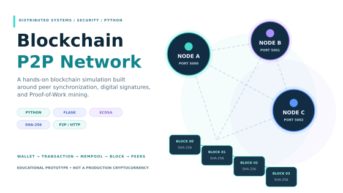
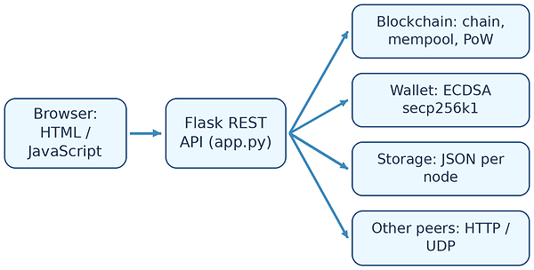
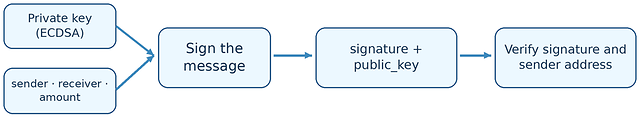
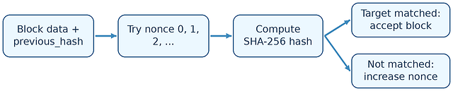
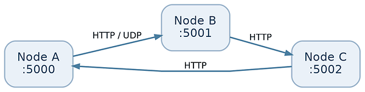
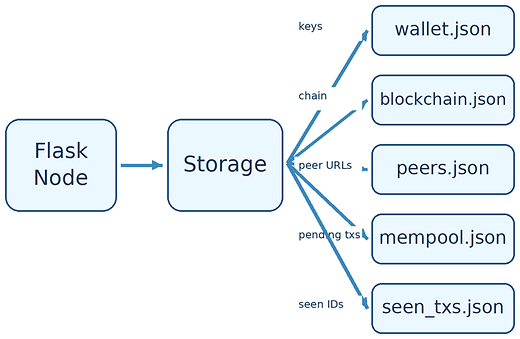
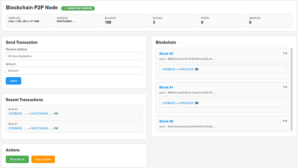

---
{
  "id": "blockchain-p2p",
  "cover": "../media/overview.svg",
  "title": "Blockchain P2P",
  "description": "I built a Python blockchain prototype to explore how signed transactions, Proof-of-Work blocks, and independent peers work together to maintain a shared ledger.",
  "category": "Distributed systems",
  "stack": [
    "Python 3",
    "Flask / REST API",
    "SHA-256 / Proof of Work",
    "ECDSA secp256k1",
    "HTTP / UDP peer networking",
    "HTML / CSS / JavaScript"
  ],
  "repository": "https://github.com/vuongthm/blockchain-p2p",
  "status": "active",
  "year": "2026",
  "order": 24,
  "translations": {
    "ja": {
      "description": "PythonとFlaskで署名付き取引、Proof of Work、P2Pノード間の通信、ブロックチェーン同期を実装し、分散台帳の基本動作を学ぶプロジェクト。"
    },
    "zh": {
      "description": "使用Python和Flask实现签名交易、工作量证明、P2P节点通信与区块链同步，以探索分布式账本的基本运行机制。"
    }
  }
}
---

## Overview

Imagine sending a transaction from one computer while two other computers maintain their own copies of the same blockchain. **Who checks the signature? When does the transaction become part of a block? And what happens if the nodes disagree about the latest chain?** I wanted to understand these questions beyond diagrams and textbook explanations.

That led me to build **Blockchain P2P**, a small blockchain network written in **Python and Flask**. Instead of using an existing blockchain platform, I implemented the core pieces myself: **SHA-256-linked blocks, ECDSA wallets, a pending-transaction pool, Proof-of-Work mining, HTTP peer communication, local-network discovery, and per-node JSON storage**. I also created a browser interface so I could inspect the node's state and trigger operations without sending every request manually.

The goal is to **observe how the components interact in a distributed application**. This is an educational prototype—not a public cryptocurrency, a secure payment service, or a production consensus network.

*The key ideas behind the project: signed transactions, mining, and peer-to-peer synchronization.*

## How does it work?

### Following an action through a blockchain node

I organized the implementation around **four Python modules**. `app.py` runs the Flask API and coordinates network messages. `blockchain.py` contains the chain, transaction pool, mining logic, and validation rules. `wallet.py` generates keys and signs transactions using **ECDSA on secp256k1**. `storage.py` writes the wallet, blockchain, mempool, and peer list to **separate JSON files for each node**. The interface is served from `templates/index.html`.

This separation helps me follow an action end to end. Clicking a button in the browser reaches a Flask endpoint; the endpoint calls the appropriate wallet or blockchain operation; the resulting state is saved locally and, when applicable, sent to other peers. Each node is a separate process with its **own state**, not a frontend connected to one shared database.

*The browser communicates with the Flask API, which coordinates chain operations, signing, local JSON storage, and peer messages.*

### What happens when I send a transaction?

A wallet generates a private/public key pair and derives a **40-character hexadecimal address** from the public key. To create a transfer, the wallet signs the sender, receiver, and amount fields. The receiving node checks the signature and whether the public key matches the sender address. It also applies basic rules for the receiving address, available balance, already-pending spending, and duplicate transaction IDs.

If the transaction passes those checks, it enters the **mempool** and can be propagated to peers using `POST /transactions/new`. **Pending does not mean confirmed**: a transaction can appear in a node's mempool before it appears in any accepted block. The project uses balance-based accounting rather than Bitcoin's UTXO model.

*A transaction is signed with a private key and checked with the public key before it can enter the pending pool.*

### How is the next block mined?

When I trigger mining through `/mine`, the node builds a candidate block with a **coinbase reward** and up to **10 pending transactions**. The miner repeatedly changes a `nonce` and hashes the block until the SHA-256 result begins with **four hexadecimal zeroes**, the fixed difficulty configured in the source. The successful block stores the previous block's hash, creating the link between consecutive blocks.

The prototype also models **reward halving** and a **maximum supply**. Those rules are useful for studying the relationship between block creation and balances, but they do not establish a real cryptocurrency's security or economics. A matching hash is not sufficient by itself: the implementation also checks block continuity, reward structure, and transaction signatures.

*Mining tries different nonce values until the computed block hash meets the fixed SHA-256 difficulty target.*

### How do nodes discover each other and exchange data?

Each node exposes HTTP endpoints such as `/info`, `/chain`, `/mempool`, and `/nodes/register`. The program also has **UDP announcements on port 9999**, local-network scanning, and periodic peer-health checks to help discover nearby nodes. For a controlled demonstration, I can start several Flask processes on different ports and register peers explicitly if automatic discovery is unreliable.

When a peer is contacted, the node can retrieve its blockchain and pending transactions. Newly accepted transactions and mined blocks are also announced over HTTP. This is the part that makes the project genuinely **peer to peer**: the machines communicate with one another rather than relying on a central ledger service.

*Each Flask process maintains its own state and exchanges messages with peers over HTTP; UDP supports local discovery.*

### What if two nodes have different blockchains?

The source includes a deliberately simple conflict-resolution rule: a node fetches candidate chains, validates them, and adopts a **longer valid chain** when one is available. The `/nodes/resolve` endpoint exposes that behavior. Peers that repeatedly provide invalid chains can accumulate violations and be removed from the local peer list after a threshold.

That is a useful way to study chain synchronization, but it is **not Byzantine Fault Tolerance**. There is no formal finality protocol, and chain length alone is not a secure choice under adversarial conditions. Another detail worth noting is that a fresh genesis block uses a local timestamp; nodes are not initialized from one fixed, shared genesis hash. These limitations matter when interpreting any multi-node experiment.

### Where does each node keep its data?

The storage layer persists the wallet, blockchain, peer list, mempool, and previously seen transaction identifiers in separate JSON files. This is useful for inspecting a node after a restart and understanding which pieces of state travel across the network versus which stay local. However, the wallet file includes a private key without encryption, and keeping JSON files on disk is not a substitute for a secure key-management or database design.

*Each node keeps its wallet, chain, peer list, mempool, and seen-transaction IDs in local JSON files.*

### What can I see in the browser?

The included web dashboard exposes the wallet address and balance, chain length, connected peers, mempool size, and block information. It provides controls for **sending a transaction, mining a block, and requesting synchronization**. This makes it easier to observe how one operation changes the state returned by the API.

*A conceptual view of the dashboard controls and node state—not a screenshot of a benchmark or a verified live session.*

## How can the behavior be tested?

I documented a **reproducible manual test plan** rather than presenting unverified performance numbers. It covers **starting and restarting nodes; persistence of wallet and chain data; mining and checking the hash target; creating a valid transfer; rejecting a forged signature; discovering and registering peers; resolving a longer candidate chain; and handling an invalid block**. Useful evidence includes HTTP status codes, `/info` and `/chain` responses, before-and-after balances, chain hashes, and node logs.

The source provides the operations needed to explore these cases, but the repository **does not include a verified automated multi-node test suite or benchmark dataset**. I therefore do not claim a measured transaction throughput, convergence time, or fault-tolerance threshold. A future test run should record its environment and distinguish *passed*, *failed*, and *not run* cases.

### Which security boundaries are still missing?

Public-facing APIs, information received from peers, and locally stored credentials cross different trust boundaries. The source can reject some malformed data and blacklist repeat offenders, but it does not add strong API authentication, encrypted wallet custody, or a formally specified consensus layer. I therefore treat the system as an isolated educational experiment and do not use it to store assets or expose an unauthenticated node to the Internet.

## What I learned

My biggest takeaway is that **a valid signature, a valid block, and agreement between nodes are three different problems**. A signature verifies control of a key, but a transfer still needs balance and duplicate-spending checks. A block can satisfy the Proof-of-Work target while the network still disagrees about which history to use. And receiving a message over HTTP is not the same as having a reliable distributed protocol.

Building the pieces together also exposed practical design questions: how to reconcile independent state, how to handle duplicate messages, what should happen after a restart, and why all nodes need a clearly defined starting point. I learned to treat **cryptography, application validation, and peer synchronization as separate layers**—and to inspect the actual code path before making security claims.

## Source code

The codebase includes `app.py`, `blockchain.py`, `wallet.py`, `storage.py`, `requirements.txt`, and the web interface in `templates/index.html`. A useful way to explore it is to run one node, submit a transaction, mine a block, then start another node and observe how state is exchanged. The repository README contains the basic setup instructions.

This is a learning project intended for controlled environments. Private keys are not encrypted at rest, and the API does not have the protections required for public deployment.

**GitHub:** [vuongthm/blockchain-p2p](https://github.com/vuongthm/blockchain-p2p)
