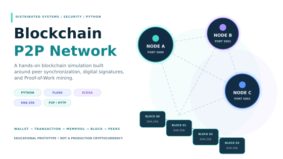
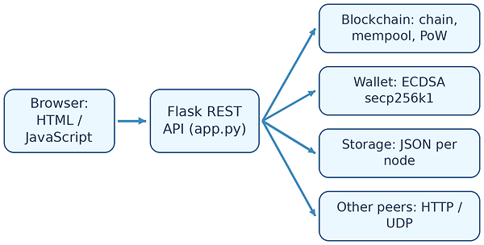
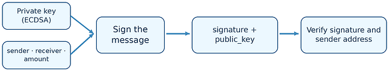
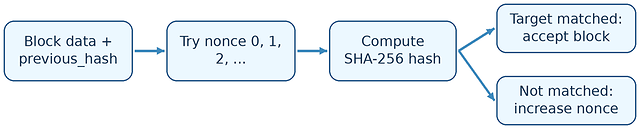
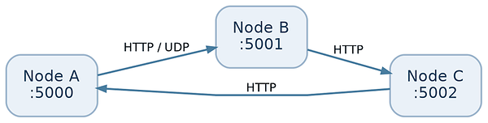
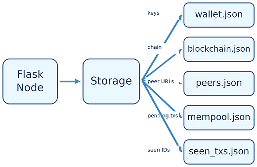
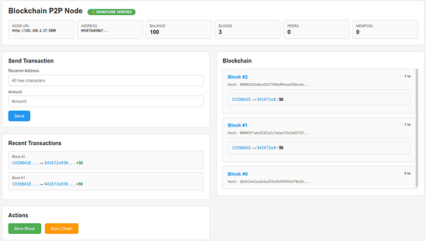

---
{
  "id": "blockchain-p2p",
  "cover": "../media/overview.svg",
  "title": "Blockchain P2P",
  "description": "Mình xây dựng mô hình blockchain bằng Python để tìm hiểu cách giao dịch được ký số, khối được đào bằng Proof of Work và các node độc lập phối hợp duy trì sổ cái.",
  "category": "Distributed systems",
  "stack": [
    "Python 3",
    "Flask / REST API",
    "SHA-256 / Proof of Work",
    "ECDSA secp256k1",
    "HTTP / UDP peer networking",
    "HTML / CSS / JavaScript"
  ],
  "repository": "https://github.com/vuongthm/blockchain-p2p",
  "status": "active",
  "year": "2026",
  "order": 24,
  "translations": {
    "ja": {
      "description": "PythonとFlaskで署名付き取引、Proof of Work、P2Pノード間の通信、ブロックチェーン同期を実装し、分散台帳の基本動作を学ぶプロジェクト。"
    },
    "zh": {
      "description": "使用Python和Flask实现签名交易、工作量证明、P2P节点通信与区块链同步，以探索分布式账本的基本运行机制。"
    }
  }
}
---

## Tổng quan

Giả sử mình gửi một giao dịch từ máy tính A, trong khi hai máy B và C cũng đang lưu blockchain của riêng mình. **Ai sẽ xác thực chữ ký? Khi nào giao dịch thực sự trở thành một phần của blockchain? Và nếu các máy đang giữ những chuỗi khác nhau, chúng sẽ thống nhất dữ liệu bằng cách nào?** Mình muốn tự lập trình để hiểu các bước này thay vì chỉ tìm hiểu chúng qua sơ đồ lý thuyết.

Vì vậy, mình xây dựng **Blockchain P2P** — một mô hình mạng blockchain bằng **Python và Flask**. Không sử dụng nền tảng blockchain có sẵn, mình triển khai những thành phần cơ bản: **khối liên kết bằng SHA-256, ví và chữ ký ECDSA, hàng đợi giao dịch, đào khối Proof of Work, giao tiếp HTTP giữa các node, khám phá peer trong mạng nội bộ và lưu dữ liệu JSON riêng cho từng node**. Dự án còn có giao diện web để theo dõi trạng thái và thao tác trực tiếp.

Điều mình muốn hiểu rõ nhất là **cách những thành phần này phối hợp trong một ứng dụng phân tán**. Đây là mô hình học tập và thực nghiệm, **không phải một đồng tiền mã hóa công khai, dịch vụ thanh toán an toàn hay hệ thống đồng thuận đủ tiêu chuẩn sản xuất**.

*Các thành phần chính trong mô hình: giao dịch, đào khối và đồng bộ dữ liệu giữa các node.*

## Cách hoạt động

### Một thao tác đi qua những thành phần nào?

Mình chia chương trình thành **bốn mô-đun Python**. `app.py` vận hành Flask API và điều phối hoạt động mạng; `blockchain.py` xử lý chuỗi khối, mempool, đào khối và các quy tắc xác thực; `wallet.py` tạo khóa và ký giao dịch bằng **ECDSA trên đường cong secp256k1**; `storage.py` lưu ví, blockchain, mempool và danh sách peer trong **các tệp JSON riêng của từng node**. Giao diện web nằm trong `templates/index.html`.

Cách tổ chức này giúp mình theo dõi một hành động từ đầu đến cuối: người dùng thao tác trên trình duyệt, Flask nhận yêu cầu, mô-đun tương ứng xử lý, dữ liệu được lưu cục bộ và khi phù hợp sẽ được gửi đến những peer khác. Mỗi node là **một tiến trình độc lập với trạng thái riêng**, chứ không phải nhiều giao diện cùng truy cập một cơ sở dữ liệu chung.

*Trình duyệt gửi thao tác đến Flask API; chương trình điều phối blockchain, ví, dữ liệu JSON và các thông điệp tới peer.*

### Điều gì xảy ra khi mình gửi một giao dịch?

Ví tạo cặp khóa riêng/khóa công khai và sinh **địa chỉ gồm 40 ký tự thập lục phân** từ khóa công khai. Khi chuyển tiền, ví ký các trường người gửi, người nhận và số lượng. Node tiếp nhận sẽ kiểm tra chữ ký, đối chiếu khóa công khai với địa chỉ người gửi, sau đó áp dụng các điều kiện cơ bản về địa chỉ nhận, số dư, số tiền đang chờ sử dụng và mã giao dịch trùng lặp.

Giao dịch được chấp nhận sẽ vào **mempool** và có thể được chuyển đến các peer qua `POST /transactions/new`. **Có mặt trong mempool chưa có nghĩa đã được xác nhận**: giao dịch chỉ trở thành một phần của blockchain sau khi được đưa vào một khối hợp lệ. Dự án theo dõi số dư theo địa chỉ, không triển khai mô hình UTXO của Bitcoin.

*Ví ký giao dịch bằng khóa riêng; node kiểm tra chữ ký và các điều kiện giao dịch trước khi đưa vào mempool.*

### Node đào một khối mới như thế nào?

Khi mình kích hoạt `/mine`, node tạo khối ứng viên gồm **giao dịch thưởng đào** và tối đa **10 giao dịch đang chờ**. Chương trình liên tục thay đổi giá trị `nonce` rồi băm nội dung khối bằng SHA-256 cho đến khi kết quả bắt đầu bằng **bốn ký tự `0` hệ thập lục phân** — mức khó cố định trong mã nguồn. Khối mới lưu mã băm của khối trước, tạo liên kết giữa các khối liên tiếp.

Hệ thống còn mô phỏng **chu kỳ giảm phần thưởng** và **giới hạn tổng cung**. Những tham số này giúp mình quan sát sự liên hệ giữa quá trình đào khối và số dư, nhưng không chứng minh tính an toàn kinh tế của một đồng tiền mã hóa thực tế. Bên cạnh điều kiện mã băm, mã nguồn cũng kiểm tra tính liên tục của chuỗi, cấu trúc phần thưởng và chữ ký giao dịch.

*Node liên tục thử nonce và tính SHA-256 đến khi mã băm đáp ứng độ khó cố định của mô hình.*

### Các node tìm thấy nhau và trao đổi dữ liệu ra sao?

Mỗi node cung cấp các HTTP endpoint như `/info`, `/chain`, `/mempool` và `/nodes/register`. Chương trình còn phát **thông báo UDP trên cổng 9999**, quét mạng nội bộ và định kỳ kiểm tra trạng thái peer. Khi mô phỏng, mình có thể chạy nhiều tiến trình Flask trên các cổng khác nhau và đăng ký node thủ công nếu cơ chế tự khám phá không hoạt động ổn định trong môi trường hiện tại.

Khi kết nối với peer, node có thể lấy chuỗi khối và những giao dịch đang chờ từ phía bên kia. Giao dịch mới và khối vừa đào cũng có thể được thông báo qua HTTP. Đây là phần giúp chương trình mang tính **ngang hàng**: các node trao đổi trực tiếp, không phải cùng phụ thuộc vào một dịch vụ sổ cái tập trung.

*Mỗi tiến trình Flask có dữ liệu riêng và trao đổi qua HTTP; UDP giúp tìm peer trong mạng nội bộ.*

### Nếu hai node giữ blockchain khác nhau thì sao?

Mã nguồn sử dụng một quy tắc giải quyết xung đột đơn giản: node lấy những chuỗi ứng viên từ peer, xác thực chúng và lựa chọn **chuỗi hợp lệ dài hơn** khi có. Hành vi này được đưa ra qua endpoint `/nodes/resolve`. Node gửi chuỗi không hợp lệ nhiều lần có thể bị ghi nhận vi phạm và bị loại khỏi danh sách peer cục bộ sau khi đạt ngưỡng.

Cơ chế trên đủ để nghiên cứu bước đầu về đồng bộ chuỗi, nhưng **không phải Byzantine Fault Tolerance hoàn chỉnh**. Hệ thống chưa có cơ chế bảo đảm tính chung cuộc, còn việc chọn chuỗi chỉ theo độ dài không đủ an toàn trước đối thủ có chủ đích. Một giới hạn khác trong mã nguồn là **genesis block mới được tạo với dấu thời gian cục bộ**, thay vì dùng chung một genesis hash cố định cho toàn mạng. Đây là điểm cần lưu ý khi diễn giải các bài thử nhiều node.

### Mỗi node lưu dữ liệu ở đâu?

Lớp lưu trữ ghi ví, blockchain, danh sách peer, mempool và các mã giao dịch đã gặp vào những tệp JSON riêng. Nhờ đó, mình có thể kiểm tra dữ liệu sau khi khởi động lại node và phân biệt trạng thái lưu cục bộ với thông tin được trao đổi qua mạng. Tuy nhiên, tệp ví hiện chứa khóa riêng **chưa mã hóa**, và JSON trên đĩa không thay thế được cơ chế quản lý khóa hay cơ sở dữ liệu an toàn dành cho môi trường sản xuất.

*Ví, blockchain, peer, mempool và các mã giao dịch đã nhận được lưu riêng ở từng node.*

### Giao diện web giúp mình quan sát những gì?

Dashboard hiển thị địa chỉ và số dư ví, độ dài blockchain, peer đã kết nối, số giao dịch đang chờ và thông tin khối. Giao diện hỗ trợ **gửi giao dịch, đào khối và yêu cầu đồng bộ** để có thể quan sát trực tiếp một thao tác làm thay đổi dữ liệu trả về từ API như thế nào.

*Hình minh họa cách quan sát và thao tác trên dashboard; không phải ảnh benchmark hoặc bằng chứng chạy thử đã xác minh.*

## Mình có thể kiểm tra những gì?

Mình đã xây dựng **tài liệu kịch bản kiểm thử thủ công có thể tái lập** thay vì đưa ra các số đo hiệu năng chưa được kiểm chứng. Những tình huống chính gồm **khởi động và khởi động lại node; kiểm tra dữ liệu ví/chuỗi được lưu; đào khối và đối chiếu điều kiện hash; tạo giao dịch hợp lệ; gửi chữ ký giả; tìm kiếm và đăng ký peer; thử đồng bộ chuỗi ứng viên dài hơn; và gửi khối sai thông tin liên kết**. Dữ liệu cần thu thập gồm HTTP status, kết quả `/info` và `/chain`, số dư trước/sau, mã băm chuỗi và nhật ký node.

Mã nguồn có các endpoint phục vụ những phép thử đó, nhưng repository **chưa kèm bộ kiểm thử tích hợp nhiều node được xác minh độc lập hay tập dữ liệu benchmark**. Vì vậy mình không khẳng định thông lượng giao dịch, thời gian hội tụ hoặc ngưỡng chịu lỗi định lượng. Những lần chạy thử tiếp theo cần lưu môi trường thực hiện và phân biệt rõ trường hợp *đạt*, *không đạt* và *chưa chạy*.

### Những ranh giới bảo mật nào chưa được bảo vệ đầy đủ?

API truy cập từ bên ngoài, dữ liệu do peer gửi đến và thông tin nhạy cảm nằm trên máy đều thuộc những ranh giới tin cậy khác nhau. Mã nguồn có khả năng loại một số dữ liệu không hợp lệ và blacklist peer vi phạm nhiều lần, nhưng chưa có xác thực API mạnh, mã hóa khóa ví hoặc một giao thức đồng thuận được đặc tả đầy đủ. Vì thế, mình chỉ sử dụng hệ thống như mô hình thí nghiệm trong mạng có kiểm soát, không coi đây là hạ tầng giữ tài sản hoặc node an toàn để mở công khai trên Internet.

## Những điều mình học được

Điều quan trọng nhất mình rút ra là **chữ ký hợp lệ, khối hợp lệ và sự đồng thuận giữa các node là ba bài toán khác nhau**. Chữ ký giúp xác nhận dữ liệu gắn với khóa tương ứng, nhưng giao dịch vẫn cần kiểm tra số dư và chi tiêu trùng. Một khối có thể đáp ứng điều kiện Proof of Work trong khi các node vẫn chưa thống nhất về lịch sử giao dịch. Tương tự, gửi HTTP thành công chưa đủ chứng minh đã có một giao thức phân tán đáng tin cậy.

Việc tự kết nối các thành phần còn giúp mình nhìn rõ những câu hỏi thực tế: dữ liệu độc lập được hòa giải ra sao, cách xử lý thông điệp trùng lặp, trạng thái được khôi phục thế nào khi khởi động lại, và vì sao các node cần một điểm bắt đầu thống nhất. Mình học được cách tách **mật mã học, quy tắc xác thực nghiệp vụ và đồng bộ ngang hàng** thành những lớp có thể kiểm tra riêng, trước khi đưa ra kết luận về bảo mật.

## Mã nguồn

Mã nguồn của mình gồm `app.py`, `blockchain.py`, `wallet.py`, `storage.py`, `requirements.txt` và giao diện `templates/index.html`. Mình có thể chạy một node trước, thử gửi giao dịch và đào khối, rồi mở thêm node để quan sát dữ liệu được trao đổi. Các bước khởi chạy cơ bản cũng được ghi trong `README.md` của dự án.

Đây là mô hình thực nghiệm nên mình chỉ khuyến nghị chạy trong môi trường được kiểm soát. Khóa riêng hiện chưa được mã hóa khi lưu, và API chưa có đầy đủ các lớp bảo vệ cần thiết để triển khai công khai.

**GitHub:** [vuongthm/blockchain-p2p](https://github.com/vuongthm/blockchain-p2p)
