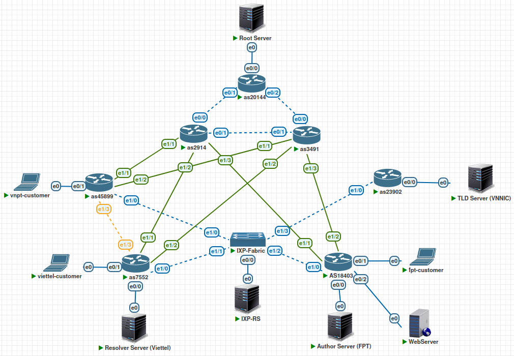
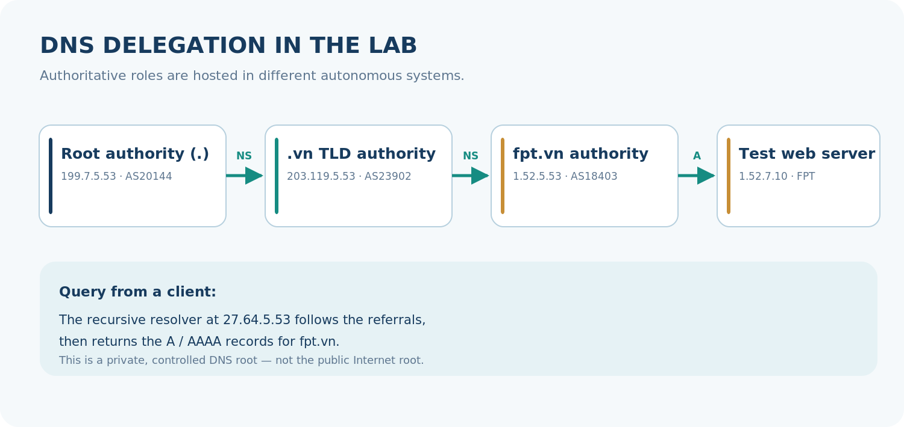
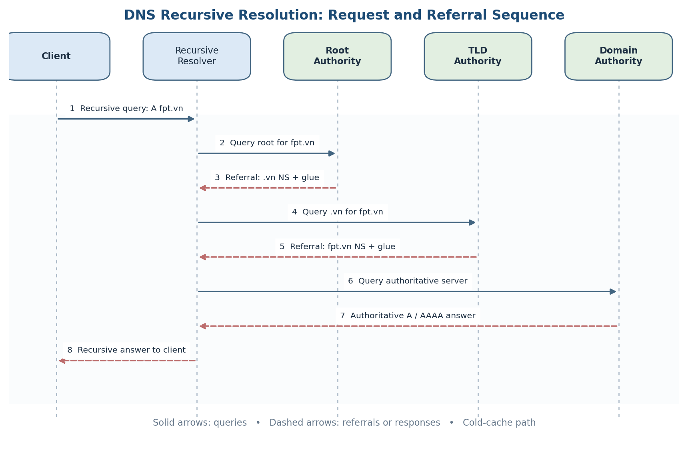
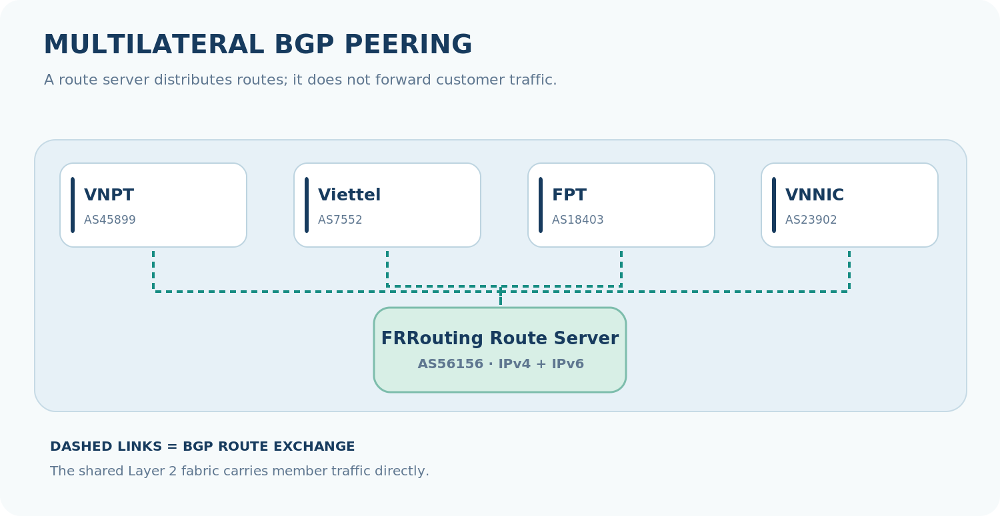
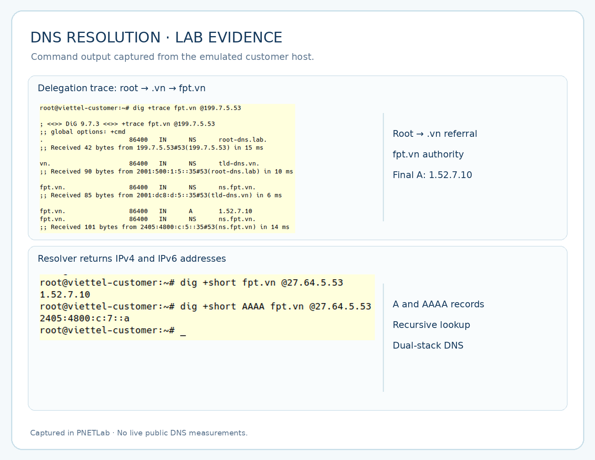
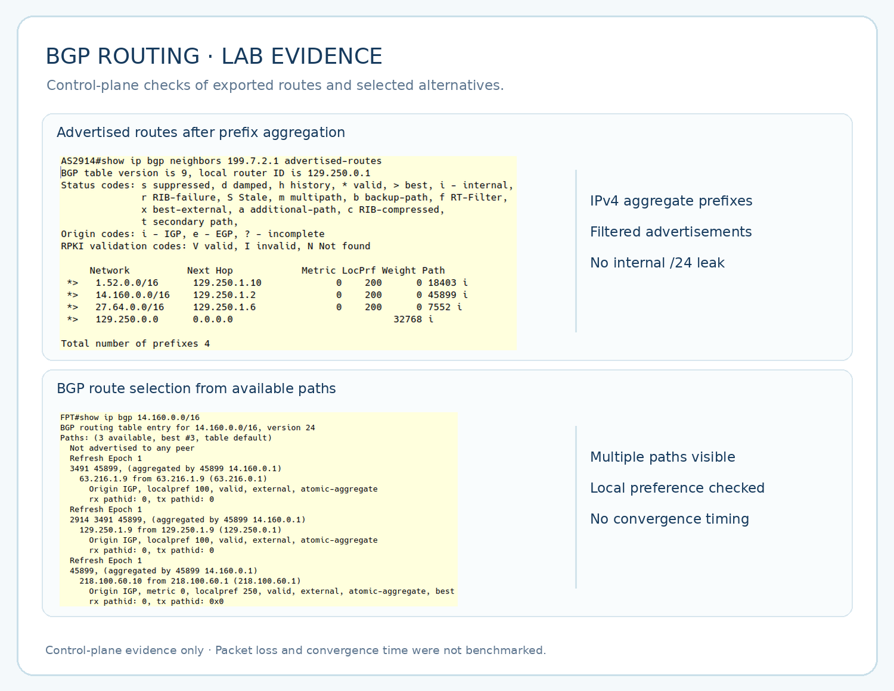

---
{
  "id": "dns-bgp-lab",
  "cover": "../media/overview.svg",
  "title": "DNS & BGP Resolution Lab",
  "category": "Network engineering",
  "stack": [
    "PNETLab",
    "Cisco IOL",
    "BGP / FRRouting",
    "BIND9 / DNS",
    "Debian 12",
    "IPv4 / IPv6"
  ],
  "repository": "https://github.com/vuongthm/dns-bgp-lab",
  "status": "active",
  "year": "2026",
  "order": 22,
  "translations": {
    "ja": {
      "description": "PNETLabで階層型DNS名前解決と複数AS間のBGPルーティングを再現し、委任、経路制御、障害時の代替経路とIPv4/IPv6を検証する。"
    },
    "zh": {
      "description": "基于PNETLab模拟分层DNS解析与多自治系统BGP路由，并验证域名委派、路由策略、链路故障切换及IPv4/IPv6连通性。"
    }
  },
  "description": "I built a PNETLab environment to explore hierarchical DNS resolution and the BGP paths connecting independent networks, including failover and IPv4/IPv6 testing."
}
---

## Overview

When I enter `fpt.vn` in a browser, how does my computer find the website's address? And if the DNS server sits in another network, how do packets reach it? Those two questions inspired **DNS & BGP Resolution Lab**.

I built this project in **PNETLab** to explore both sides of a website visit: **DNS finds the IP address**, while **BGP helps independent networks find paths to that address**. Rather than testing the protocols separately, I combined them in one environment so I could see what happens when a DNS lookup succeeds, a routing policy changes, or a network link goes down.

The lab contains **8 autonomous systems (ASes) and 17 nodes**: **7 Cisco IOL routers, 1 Layer 2 switch, 1 FRRouting route server, 4 BIND9 DNS servers, 3 client hosts, and 1 test web server**. Everything runs in an isolated emulation rather than on the public Internet. Names such as VNPT, Viettel, FPT, and VNNIC represent network roles in the scenarios—not the organizations' live configurations.

*The lab topology brings together three international ASes, simulated domestic networks, a route server, and four DNS roles.*

## How does it work?

### Following a DNS query

I separated DNS into **four roles**, each running on **Debian 12 with BIND9**: a **root server** in AS20144, the **`.vn` TLD server** in AS23902, the **authoritative server for `fpt.vn`** in AS18403, and a **recursive resolver** in AS7552.

A client sends its query to the resolver at `27.64.5.53`. If the answer is not already cached, the resolver starts at the root, follows the referral to `.vn`, asks the authoritative server for `fpt.vn`, and returns the IP address to the client. I configured the **NS, glue, A, and AAAA records** needed to make that delegation chain work inside the lab.

*These DNS authorities are part of a closed lab: `fpt.vn` points to a test web server at `1.52.7.10`, not to the public DNS record.*

*The client asks the resolver once; the resolver sends iterative queries to the root, TLD, and authoritative server before replying.*

### Connecting networks with BGP

To make those DNS servers reachable, I also built a **multi-AS BGP routing environment**. AS20144 acts as a *peer-only* international network hosting the root server. AS2914 and AS3491 provide **two transit paths** for the simulated VNPT, Viettel, and FPT networks. VNPT and Viettel have an additional direct **PNI** connection, while VNPT, Viettel, FPT, and VNNIC exchange routing information through **route server AS56156** on an emulated IXP switching fabric.

*The route server exchanges BGP information on behalf of members; user traffic does not pass through the route server itself.*

The part I spent the most time on was **routing policy**. I used **prefix lists, AS-PATH filters, and route maps** to control which routes each network could accept or advertise, while announcing only the aggregated prefixes defined by the design. **PNI and route-server paths** receive `local-preference 250`, compared with `100` for **transit**. Since PNI and route-server paths have the same preference, I do not assume one always wins; the remaining BGP best-path rules can decide between them. The eBGP sessions use **TCP MD5 authentication**, and the lab includes both **IPv4 and IPv6**.

### Checking the whole path, from DNS to the website

I did not stop after seeing an *Established* BGP session or an active BIND9 service. I checked each layer in sequence: **interfaces and links → BGP sessions → routing tables → DNS zones → `dig` responses → access to the test website**. That distinction matters: a correct DNS record does not guarantee packet delivery, and an established BGP session does not guarantee the expected prefixes have been received.

## What did I test?

I built **8 practical test scenarios** covering the core mechanisms: **prefix aggregation and AS-PATH filtering; route-server AS-PATH transparency; local-preference-based path selection; mismatched MD5 credentials; failover after a transit link goes down; DNS query tracing with `tcpdump`; authoritative-versus-recursive responses; and dual-stack IPv4/IPv6 checks using `dig AAAA`, `ping6`, and `traceroute6`**.

*The `dig +trace` and `dig` outputs show the delegation chain and the A/AAAA answers returned by the resolver in the lab.*

*CLI snapshots show advertised routes, applied filters, and path selection; they are not measurements of convergence time.*

Across these tests, I observed **DNS resolution from root to authority**, **IPv4/IPv6 answers**, the effect of **BGP policies**, and the availability of **alternative paths** during simulated failures. I also want to be clear about the limits: this is a **virtual lab**, not a production benchmark. I did not measure DNS latency, BGP convergence time, or throughput quantitatively, and **DNSSEC was not implemented**.

## What I learned

My biggest takeaway was seeing how closely **DNS and routing depend on each other**. When a domain lookup fails, I need to investigate zone data and delegation, resolver behavior, and network reachability—not immediately assume that DNS itself is broken. Likewise, a successful lookup does not automatically mean the website is reachable.

The project also gave me a clearer understanding of the **Control Plane** (BGP routes and policies) versus the **Data Plane** (whether packets actually get through). Creating controlled failures, comparing before-and-after behavior, and collecting evidence from multiple layers is an approach I would like to carry into real-world network engineering work.

## Configuration and documentation

I keep **device-specific configurations** in `configuration/`, covering routers, switches, FRRouting, BIND9, and client hosts. The `report/` directory now contains **both the Vietnamese and English PDF reports**, with the full architecture, implementation details, and test scenarios. This page is the short introduction; anyone interested in the details can explore the configurations and reports in the repository.

One important note: the AS numbers, prefixes, and network names are used **to model connectivity relationships**. They should not be mistaken for the current production infrastructure or routing policies of similarly named organizations.

**GitHub:** [vuongthm/dns-bgp-lab](https://github.com/vuongthm/dns-bgp-lab)
