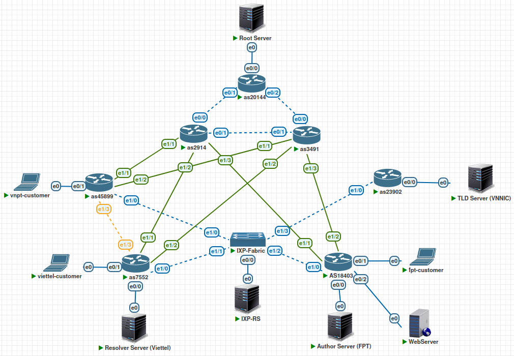
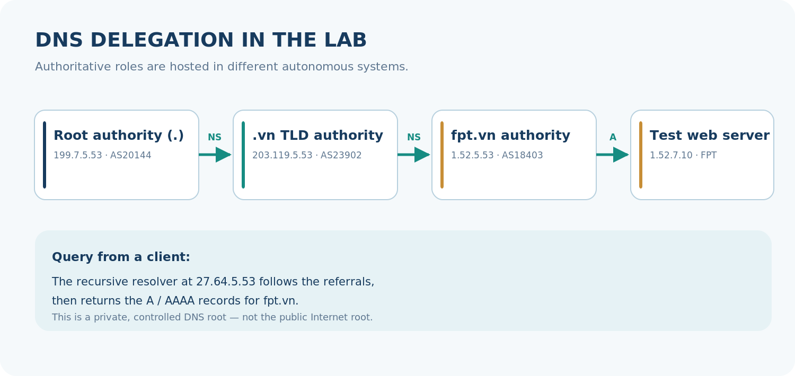
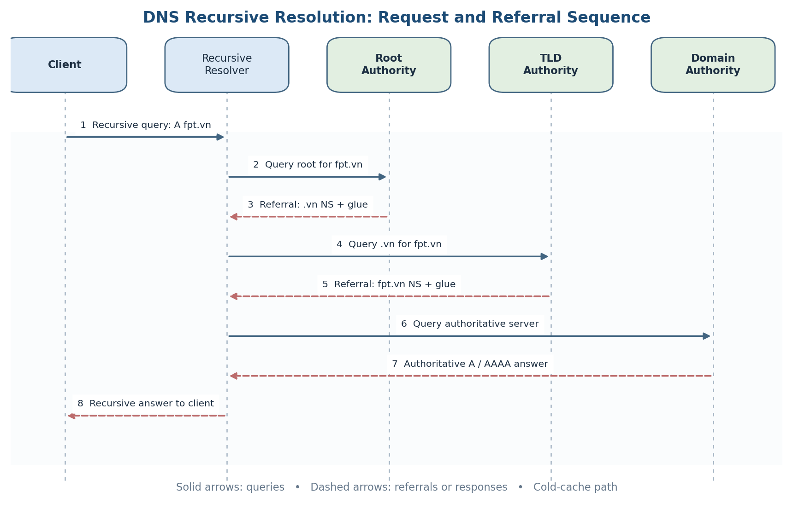
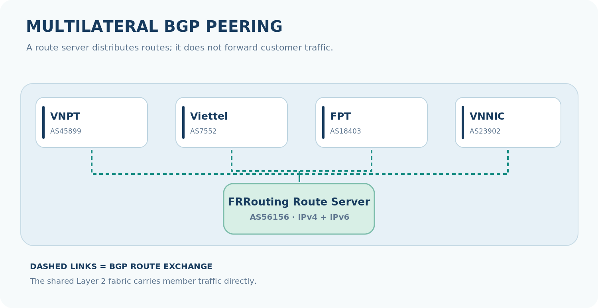
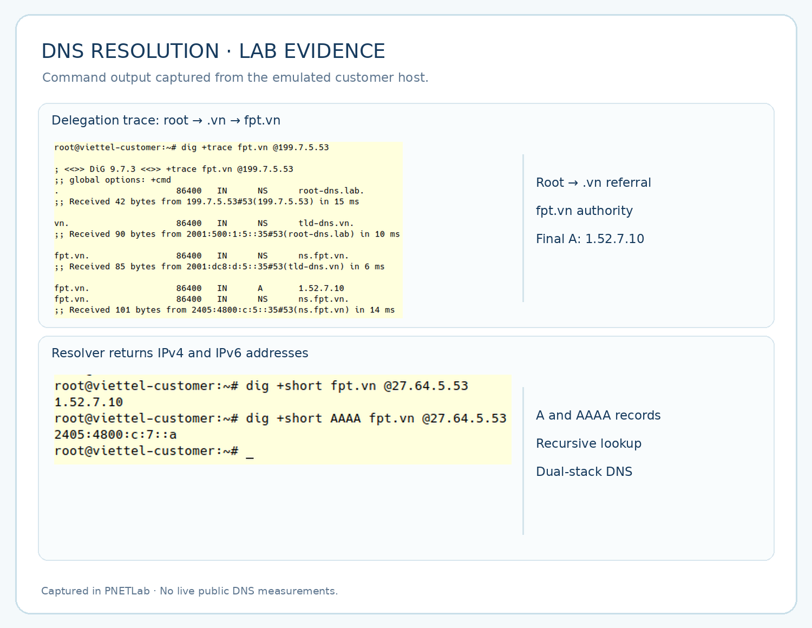
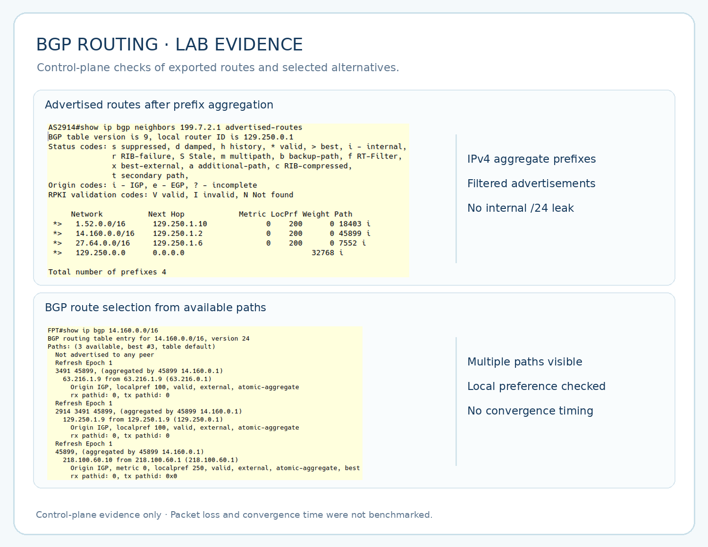

---
{
  "id": "dns-bgp-lab",
  "cover": "../media/overview.svg",
  "title": "DNS & BGP Resolution Lab",
  "category": "Network engineering",
  "stack": [
    "PNETLab",
    "Cisco IOL",
    "BGP / FRRouting",
    "BIND9 / DNS",
    "Debian 12",
    "IPv4 / IPv6"
  ],
  "repository": "https://github.com/vuongthm/dns-bgp-lab",
  "status": "active",
  "year": "2026",
  "order": 22,
  "translations": {
    "ja": {
      "description": "PNETLabで階層型DNS名前解決と複数AS間のBGPルーティングを再現し、委任、経路制御、障害時の代替経路とIPv4/IPv6を検証する。"
    },
    "zh": {
      "description": "基于PNETLab模拟分层DNS解析与多自治系统BGP路由，并验证域名委派、路由策略、链路故障切换及IPv4/IPv6连通性。"
    }
  },
  "description": "Mình xây dựng một lab trên PNETLab để quan sát cách DNS phân giải tên miền qua nhiều cấp máy chủ và cách BGP kết nối các mạng độc lập, với kiểm thử dự phòng và IPv4/IPv6."
}
---

## Tổng quan

Khi mình gõ `fpt.vn` vào trình duyệt, máy tính tìm ra địa chỉ của website bằng cách nào? Và nếu máy chủ DNS nằm ở một mạng khác, gói tin sẽ đi qua những đâu để đến được đó? Hai câu hỏi này là điểm bắt đầu của **DNS & BGP Resolution Lab**.

Mình xây dựng dự án trên **PNETLab** để nhìn rõ cả hai phần của một lần truy cập: **DNS giúp tìm địa chỉ IP**, còn **BGP giúp các mạng độc lập biết đường đi đến địa chỉ đó**. Thay vì thử riêng từng giao thức, mình đưa chúng vào cùng một mô hình để quan sát điều gì xảy ra khi truy vấn DNS hoạt động bình thường, khi chính sách định tuyến thay đổi hoặc khi một đường kết nối gặp sự cố.

Lab có **8 hệ thống tự trị (AS) và 17 node**: **7 router Cisco IOL, 1 switch lớp 2, 1 route-server chạy FRRouting, 4 máy chủ DNS chạy BIND9, 3 máy khách và 1 web server thử nghiệm**. Toàn bộ được triển khai trong môi trường giả lập riêng, không kết nối vào hạ tầng Internet công cộng. Các tên VNPT, Viettel, FPT và VNNIC chỉ thể hiện vai trò mạng trong kịch bản, không phải cấu hình đang vận hành của các đơn vị đó.

*Topology của lab: ba AS quốc tế, các mạng nội địa mô phỏng, route-server và hệ thống DNS nhiều cấp.*

## Hệ thống hoạt động như thế nào?

### Theo dấu một truy vấn DNS

Mình tách hệ thống DNS thành **bốn vai trò**, mỗi vai trò chạy trên một máy chủ **Debian 12 với BIND9**: máy chủ **Root** ở AS20144, máy chủ quản lý **TLD `.vn`** ở AS23902, máy chủ **authoritative cho `fpt.vn`** ở AS18403 và **recursive resolver** ở AS7552.

Máy khách gửi câu hỏi đến resolver tại `27.64.5.53`. Nếu chưa có câu trả lời trong cache, resolver bắt đầu từ Root, nhận thông tin ủy quyền đến `.vn`, tiếp tục đến máy chủ có thẩm quyền của `fpt.vn`, rồi trả địa chỉ IP cho máy khách. Mình cấu hình các bản ghi **NS, glue, A và AAAA** để chuỗi này hoạt động trong lab.

*Các cấp ủy quyền DNS được dựng trong môi trường riêng; `fpt.vn` trỏ đến web server thử nghiệm `1.52.7.10`, không phải bản ghi DNS công cộng.*

*Máy khách hỏi resolver một lần; resolver thực hiện các truy vấn lặp đến Root, TLD và authoritative server trước khi trả kết quả.*

### Kết nối các mạng bằng BGP

Để những truy vấn trên thực sự đi tới đích, mình dựng thêm **hạ tầng định tuyến BGP đa AS**. AS20144 đóng vai trò mạng quốc tế *peer-only* chứa Root Server. Hai AS2914 và AS3491 cung cấp **hai hướng transit** cho các mạng VNPT, Viettel và FPT mô phỏng. VNPT và Viettel có thêm kết nối **PNI** trực tiếp; bốn mạng VNPT, Viettel, FPT và VNNIC trao đổi thông tin định tuyến qua **route-server AS56156** trên một switch fabric mô phỏng IXP.

*Route-server giúp các thành viên trao đổi thông tin BGP; gói dữ liệu của người dùng không đi xuyên qua route-server.*

Phần mình dành nhiều thời gian nhất là **chính sách định tuyến**. Mình dùng **prefix-list, AS-PATH filter và route-map** để kiểm soát tuyến nào được nhận, tuyến nào được quảng bá, đồng thời chỉ công bố các prefix tổng hợp theo thiết kế. Đường học qua **PNI và route-server** có `local-preference 250`, còn đường **transit** có giá trị `100`. Vì PNI và route-server cùng mức ưu tiên, mình không mặc định đường nào luôn thắng; kết quả còn phụ thuộc các bước lựa chọn tuyến tiếp theo của BGP. Các phiên eBGP sử dụng **TCP MD5**, và mô hình hỗ trợ cả **IPv4 lẫn IPv6**.

### Kiểm tra từ tên miền đến website

Mình không chỉ dừng ở việc router báo phiên BGP *Established* hoặc BIND9 chạy thành công. Mình kiểm tra theo từng lớp: **interface và kết nối → phiên BGP → bảng định tuyến → các DNS zone → kết quả `dig` → khả năng truy cập web server**. Cách này giúp phân biệt lỗi DNS với lỗi đường đi: có bản ghi đúng chưa chắc gói tin đã đến nơi, và có phiên BGP hoạt động chưa chắc các prefix cần thiết đã được nhận.

## Mình đã kiểm thử những gì?

Mình xây dựng **8 kịch bản thực nghiệm** để kiểm tra những cơ chế quan trọng: **tổng hợp prefix và lọc AS-PATH; route-server giữ nguyên AS-PATH; lựa chọn đường theo local-preference; phiên BGP bị ảnh hưởng khi mật khẩu MD5 không khớp; chuyển sang đường transit dự phòng; quan sát chuỗi truy vấn DNS bằng `tcpdump`; so sánh authoritative server với recursive resolver; và kiểm tra IPv4/IPv6 bằng `dig AAAA`, `ping6`, `traceroute6`**.

*Các lệnh `dig +trace` và `dig` cho thấy chuỗi ủy quyền và kết quả A/AAAA do resolver trả về trong lab.*

*Ảnh lệnh cho thấy tuyến được quảng bá, áp dụng bộ lọc và lựa chọn đường đi; đây không phải số liệu đo thời gian hội tụ.*

Qua những thử nghiệm này, mình quan sát được **quy trình phân giải DNS từ Root đến authoritative**, kết quả phân giải **IPv4/IPv6**, tác động của **chính sách BGP** và việc sử dụng **đường thay thế** khi mô phỏng sự cố. Mình cũng giữ rõ giới hạn của dự án: đây là **lab ảo hóa**, chưa có phép đo định lượng về độ trễ phân giải DNS, thời gian hội tụ BGP hay khả năng chịu tải; **DNSSEC chưa được triển khai**.

## Điều mình học được

Điều có giá trị nhất với mình là thấy **DNS và định tuyến không hoạt động tách rời**. Khi một tên miền không phân giải được, mình cần kiểm tra cả bản ghi và cơ chế ủy quyền, trạng thái resolver, rồi mới đến khả năng tiếp cận các máy chủ qua mạng. Ngược lại, phân giải thành công cũng chưa đủ để kết luận website truy cập được.

Dự án cũng giúp mình hiểu rõ hơn sự khác nhau giữa **Control Plane** (BGP, chính sách và bảng tuyến) với **Data Plane** (gói tin thực sự đi được hay không). Việc tự tạo lỗi có kiểm soát, so sánh trạng thái trước và sau, rồi kiểm tra bằng chứng từ nhiều lớp là cách mình muốn tiếp tục áp dụng khi làm việc với hệ thống mạng thực tế.

## Cấu hình và tài liệu

Mình để **cấu hình riêng của từng thiết bị** trong `configuration/`, gồm router, switch, FRRouting, BIND9 và các máy khách. Thư mục `report/` đã có **hai bản báo cáo PDF bằng tiếng Việt và tiếng Anh**, trình bày chi tiết kiến trúc, quá trình triển khai và các kịch bản kiểm thử. Nhờ vậy, người xem có thể đọc nhanh phần giới thiệu ở đây hoặc đi sâu vào cấu hình và báo cáo khi muốn tìm hiểu kỹ hơn.

Một lưu ý nhỏ: ASN, prefix và tên các nhà mạng trong dự án được sử dụng **để mô phỏng các quan hệ kết nối**, không phản ánh hệ thống hoặc chính sách vận hành thực tế của những tổ chức trùng tên.

**GitHub:** [vuongthm/dns-bgp-lab](https://github.com/vuongthm/dns-bgp-lab)
