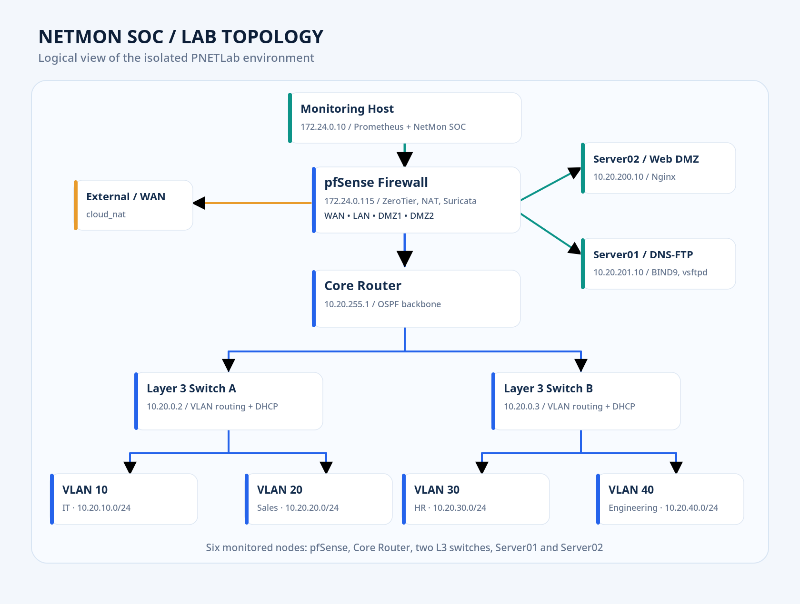
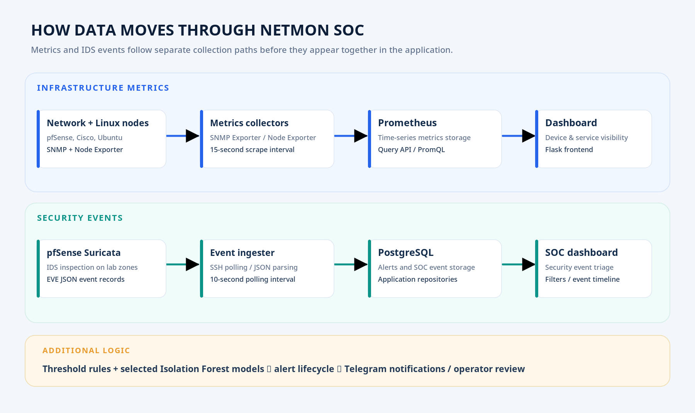
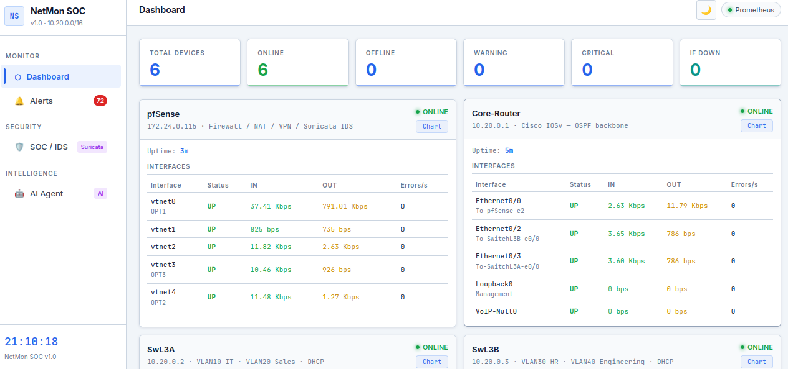
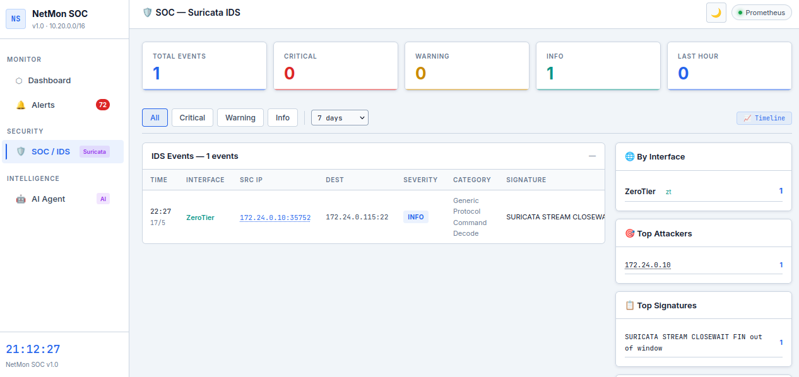
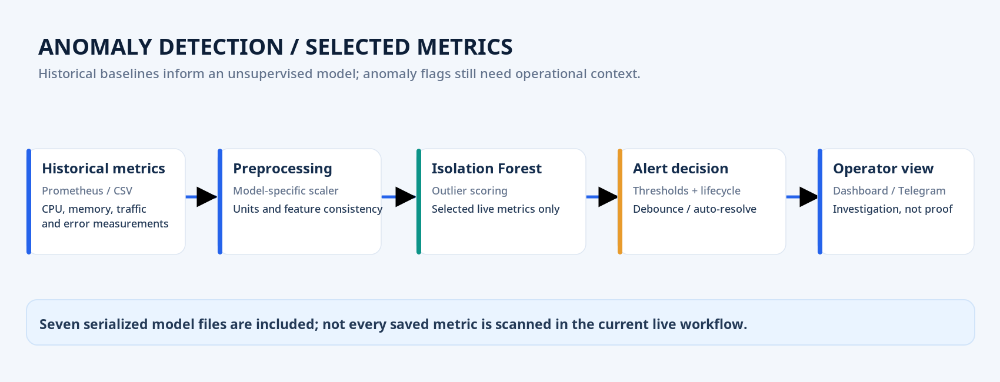
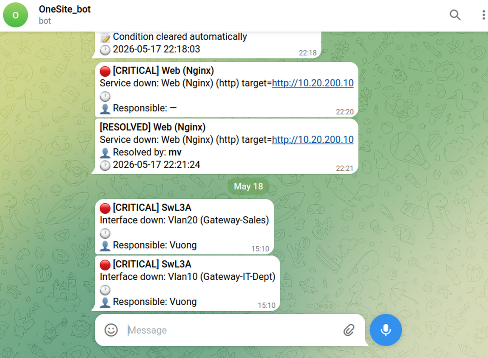
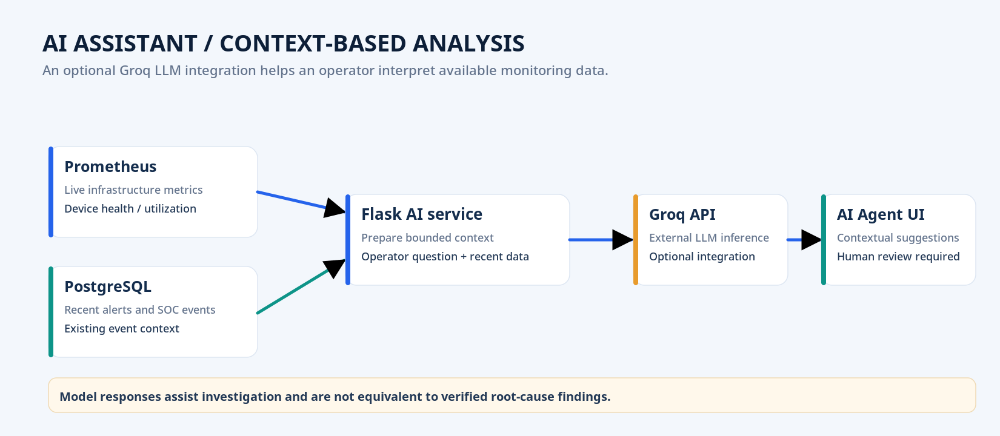

---
{
  "id": "netmon-soc-lab",
  "cover": "../media/overview.svg",
  "title": "NetMon SOC Lab",
  "description": "A PNETLab network monitoring and security-event analysis project integrating Prometheus, Suricata IDS, Isolation Forest, Telegram alerts, and AI-assisted investigation.",
  "category": "Network engineering",
  "stack": [
    "PNETLab",
    "Cisco IOSv / OSPF",
    "pfSense / ZeroTier",
    "Prometheus / SNMP",
    "Suricata IDS",
    "Flask / PostgreSQL",
    "Isolation Forest",
    "Telegram / Groq LLM"
  ],
  "repository": "https://github.com/vuongthm/netmon-soc-lab",
  "status": "active",
  "year": "2026",
  "order": 23,
  "translations": {
    "ja": {
      "description": "PNETLab上でネットワーク監視とセキュリティイベント分析を統合し、Prometheus、Suricata IDS、Isolation Forest、Telegram通知、AI支援を検証するプロジェクト。"
    },
    "zh": {
      "description": "基于PNETLab构建网络监控与安全事件分析实验环境，集成Prometheus、Suricata IDS、Isolation Forest、Telegram告警和AI辅助分析。"
    }
  }
}
---

## Overview

A network device stops responding, a server suddenly consumes almost all its CPU, or a firewall sees suspicious traffic. Checking each tool separately makes it difficult to understand what is happening across the network, especially when several events occur at once. That challenge led me to build **NetMon SOC Lab**.

Together with **Diệp Mạnh Tuấn**, I developed a **PNETLab-based experiment** that brings **infrastructure monitoring, IDS event analysis, anomaly detection, and alert management** into one Web interface. The lab represents an enterprise network with **pfSense, a core router, two Layer 3 switches, four access switches, four user VLANs, and two DMZ segments**. NetMon SOC monitors **six target devices**: pfSense, Core-Router, SwL3A, SwL3B, Server01, and Server02. A separate monitoring host connects over **ZeroTier**.

*Logical lab topology showing the VLANs, DMZs, pfSense, router/switch infrastructure, and monitoring host. This is an architectural diagram rather than a PNETLab screenshot.*

## How it works

### Bringing infrastructure metrics together

For network devices, I use **SNMP Exporter** to collect interface status and traffic measurements from pfSense, Core-Router, and the two Layer 3 switches. **Node Exporter** supplies CPU, memory, disk, and network metrics from the two Linux servers. **Prometheus scrapes these sources every 15 seconds** and stores the time-series data. The Flask application then queries that data to populate the dashboard and inform alert evaluation.

*Two distinct data paths: Prometheus stores time-series metrics, while PostgreSQL stores application alerts and security events.*

*An experiment-time dashboard showing six monitored devices, their status, and interface statistics. Values are snapshots, not continuous performance claims.*

I also added **HTTP, DNS, and TCP service checks**, because a machine replying to ping does not guarantee that its applications are healthy. This is why the dashboard combines device availability, interface state, and endpoint checks rather than relying on one signal.

### Turning Suricata events into a SOC view

**Suricata** runs on pfSense and inspects traffic on the lab's configured network zones. Instead of leaving findings scattered across log files, a background worker reads **EVE JSON over SSH** on a configured interval of approximately **10 seconds**, extracts timestamps, source/destination addresses, severities, and signatures, and stores the resulting events in **PostgreSQL**.

*The SOC dashboard provides filtering and inspection for Suricata events. The event count in the screenshot represents one observation point.*

This helps an operator move from “which device is unhealthy?” to “what happened, on which interface, and what should I inspect next?” In the isolated lab, we generated controlled cases such as **port scans, suspicious Web requests, and unusual DNS/FTP traffic** to examine the event-ingestion workflow. An IDS alert is a signal for investigation, **not proof of a successful intrusion**.

### Finding unusual behavior with Isolation Forest

Fixed thresholds work for clearly defined conditions such as high CPU usage or a down interface, but they cannot describe every unexpected change in network traffic. We therefore added **Isolation Forest** models trained on historical observations to identify measurements that deviate from a baseline. The repository includes **seven serialized model files** for resource, traffic, and error metrics. However, **the current live scanning workflow uses selected metrics**; it does not run all seven model families on every device at once.

*Conceptual flow from historical metrics and preprocessing to anomaly scoring and alerts. This illustrates system behavior, not measured detection accuracy.*

Controlled CPU/memory load and traffic changes let us observe the path from metrics to anomaly flags and alerts. I do not interpret `contamination=0.05` as a “5% false-positive rate”: that would require a separately labeled evaluation dataset.

### Managing alert lifecycles and Telegram notifications

NetMon SOC does not send a new notification for every failed reading. It implements **debouncing** to reduce transient noise, keeps track of active alerts, supports reminders, and **automatically resolves** an alert after the condition clears and a grace period passes. Notifications can be delivered through **Telegram**, so operators can see both the incident and its recovery.

*A real lab notification screenshot showing service/interface alerts and resolved messages. It demonstrates specific test cases rather than guaranteed delivery behavior.*

### An AI assistant for operational context

The optional **AI Agent** integrates with a **Groq-hosted LLM**. The Flask service gathers current device metrics from Prometheus and selected recent alerts, places them into the question context, and asks the model to explain the situation or suggest checks. I treat these responses as **investigation assistance**, not automated security decisions or a substitute for checking the devices and underlying events.

*Context-driven AI flow when Groq is configured: available monitoring data → prompt context → operator-reviewed answer.*

## Testing and observations

Our test plan covers multiple layers: **connectivity and SNMP collection**, interface/resource changes, **Suricata event ingestion**, unusual metric patterns, and **alert/Telegram lifecycles**. The technical report documents **13 out of 13 primary scenarios meeting their expected outcomes within the lab**, together with additional controlled IDS experiments involving WAN, Web, FTP, and DNS traffic. Those observations show that the components can work together in the simulated conditions; they **do not establish coverage of every attack type** or production-grade SOC reliability.

The main limitations are the small lab topology, relatively narrow training and evaluation data, and the lack of an independent labeled dataset for rigorous *precision*, *recall*, and *false-positive rate* measurements. A successful dashboard screenshot or a configured outlier proportion is not enough to claim general detection accuracy.

## What I learned

The biggest lesson is that **monitoring is more than drawing charts**. A device can be online while its service is down; an IDS alert may be meaningful or noisy; and an outlier needs context before it becomes an actionable finding. Bringing these signals into a shared workflow taught me how **network operations, security monitoring, and machine learning** can complement one another while retaining different evidentiary roles.

The project also improved my understanding of modular application design, PostgreSQL-backed event management, alert state transitions, and repeatable experiments. Just as importantly, I learned to **document what was actually implemented and tested** without presenting a promising lab result as production readiness.

## Source code and documentation

The repository includes **per-device infrastructure configuration** in `configuration/`, the **Flask application source** in `source/code/`, and the **notebook, historical datasets, and Isolation Forest artifacts** in `source/machine-learning/`. Both the **Vietnamese and English technical reports** are already available in `report/`. Lab IP addresses, access policies, and sample credentials describe a **controlled emulation environment**, not a production security baseline.

**GitHub:** [vuongthm/netmon-soc-lab](https://github.com/vuongthm/netmon-soc-lab)
