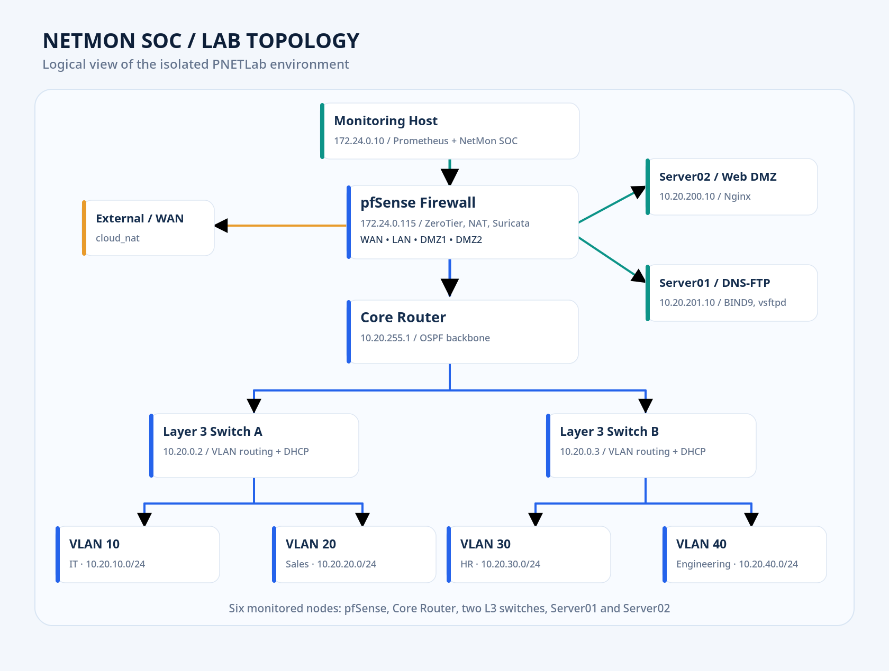
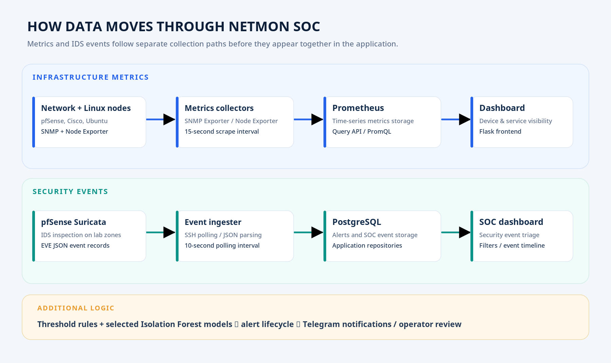
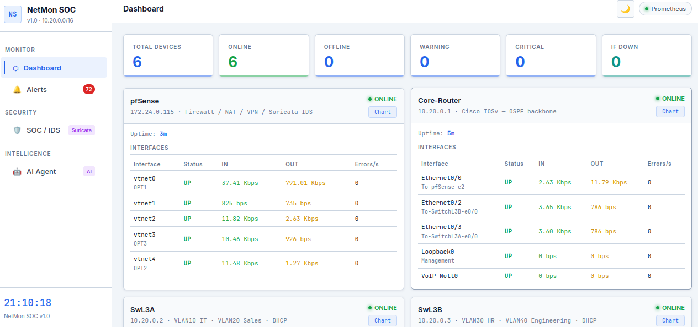
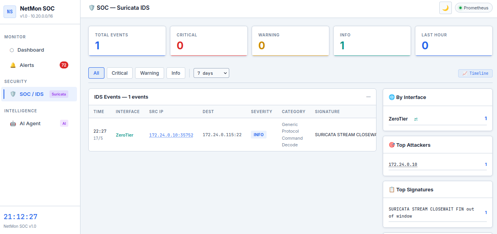
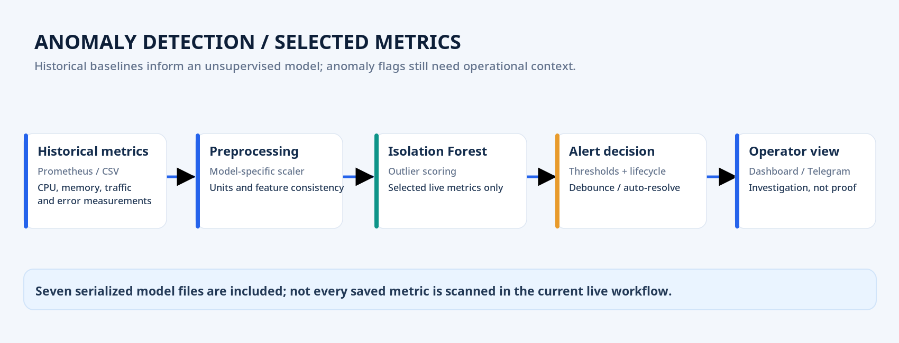
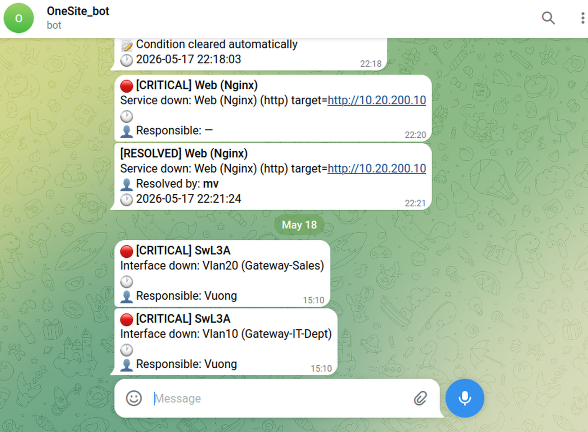
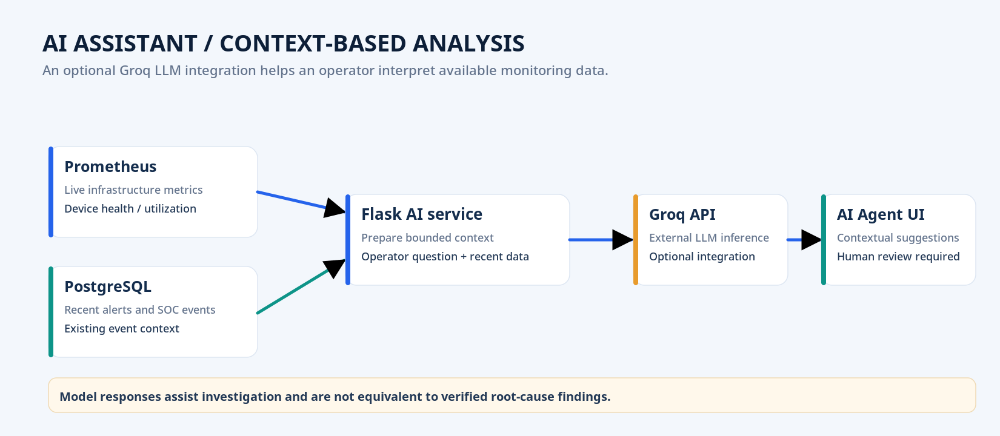

---
{
  "id": "netmon-soc-lab",
  "cover": "../media/overview.svg",
  "title": "NetMon SOC Lab",
  "description": "Xây dựng hệ thống giám sát mạng và phân tích sự kiện an ninh trên PNETLab, kết hợp Prometheus, Suricata IDS, Isolation Forest, cảnh báo Telegram và trợ lý AI.",
  "category": "Network engineering",
  "stack": [
    "PNETLab",
    "Cisco IOSv / OSPF",
    "pfSense / ZeroTier",
    "Prometheus / SNMP",
    "Suricata IDS",
    "Flask / PostgreSQL",
    "Isolation Forest",
    "Telegram / Groq LLM"
  ],
  "repository": "https://github.com/vuongthm/netmon-soc-lab",
  "status": "active",
  "year": "2026",
  "order": 23,
  "translations": {
    "ja": {
      "description": "PNETLab上でネットワーク監視とセキュリティイベント分析を統合し、Prometheus、Suricata IDS、Isolation Forest、Telegram通知、AI支援を検証するプロジェクト。"
    },
    "zh": {
      "description": "基于PNETLab构建网络监控与安全事件分析实验环境，集成Prometheus、Suricata IDS、Isolation Forest、Telegram告警和AI辅助分析。"
    }
  }
}
---

## Tổng quan

Một thiết bị mạng ngừng phản hồi, một máy chủ đột nhiên sử dụng gần hết CPU, hoặc firewall ghi nhận lưu lượng có dấu hiệu tấn công. Nếu phải mở từng công cụ để kiểm tra, người quản trị rất khó nhìn thấy bức tranh chung, nhất là khi nhiều sự kiện xảy ra cùng lúc. Đó là bài toán mình muốn giải quyết khi bắt đầu **NetMon SOC Lab**.

Mình cùng **Diệp Mạnh Tuấn** xây dựng một môi trường thử nghiệm trên **PNETLab**, kết hợp **giám sát trạng thái hạ tầng, phân tích sự kiện IDS, phát hiện bất thường và quản lý cảnh báo** trong một giao diện Web. Lab mô phỏng mạng doanh nghiệp với **pfSense, router lõi, hai switch Layer 3, bốn switch access, bốn VLAN người dùng và hai vùng DMZ**. Hệ thống NetMon SOC theo dõi **6 thiết bị mục tiêu**: pfSense, Core-Router, SwL3A, SwL3B, Server01 và Server02. Máy giám sát kết nối vào môi trường qua **ZeroTier**.

*Topology logic của môi trường giả lập: các VLAN, DMZ, pfSense, router/switch và máy giám sát. Đây là sơ đồ minh họa kiến trúc, không phải ảnh chụp trực tiếp PNETLab.*

## Cách hệ thống hoạt động

### Gom dữ liệu giám sát về một nơi

Ở lớp mạng, mình dùng **SNMP Exporter** để đọc trạng thái cổng và lưu lượng từ pfSense, Core-Router cùng hai switch Layer 3. Trên hai máy chủ Linux, **Node Exporter** cung cấp các chỉ số CPU, RAM, ổ đĩa và mạng. **Prometheus lấy mẫu 15 giây/lần**, lưu dữ liệu chuỗi thời gian; ứng dụng Flask truy vấn dữ liệu này để hiển thị tình trạng thiết bị và hỗ trợ đánh giá cảnh báo.

*Hai luồng dữ liệu chính: metrics được lưu trong Prometheus, còn sự kiện bảo mật và cảnh báo ứng dụng được lưu trong PostgreSQL.*

*Dashboard thực nghiệm hiển thị sáu thiết bị, trạng thái hoạt động và thông số interface tại thời điểm chụp.*

Mình cũng bổ sung **kiểm tra dịch vụ Web, DNS và TCP**, vì một thiết bị còn phản hồi ping không có nghĩa dịch vụ mà nó cung cấp vẫn hoạt động. Đây là lý do dashboard cần kết hợp trạng thái máy, trạng thái cổng và kết quả kiểm tra endpoint.

### Theo dõi sự kiện an ninh với Suricata IDS

**Suricata** chạy trên pfSense để quan sát lưu lượng tại các vùng mạng thử nghiệm. Thay vì chỉ để cảnh báo nằm trong những tệp log riêng lẻ, ứng dụng định kỳ đọc **EVE JSON qua SSH** (chu kỳ cấu hình khoảng **10 giây**), chuẩn hóa các trường như thời gian, IP nguồn/đích, mức độ và chữ ký phát hiện, rồi ghi sự kiện vào **PostgreSQL**.

*SOC Dashboard cho phép xem sự kiện Suricata, lọc theo mức độ, nguồn và vùng mạng. Số sự kiện trên ảnh chỉ phản ánh một thời điểm quan sát.*

Nhờ vậy, người vận hành có thể chuyển từ câu hỏi “thiết bị nào đang có vấn đề?” sang “đã xảy ra sự kiện gì, ở interface nào và cần kiểm tra gì tiếp theo?”. Trong lab, mình tạo các tình huống có kiểm soát như **port scanning, truy vấn Web đáng ngờ và lưu lượng bất thường tới DNS/FTP** để kiểm tra luồng ghi nhận sự kiện. Một cảnh báo của IDS là tín hiệu cần điều tra, không tự động chứng minh đã có xâm nhập thành công.

### Phát hiện ngoại lai bằng Isolation Forest

Giám sát bằng ngưỡng cố định phát hiện tốt các tình huống rõ ràng như CPU vượt ngưỡng hoặc interface down, nhưng khó mô tả mọi thay đổi bất thường của lưu lượng. Vì vậy, nhóm kết hợp **Isolation Forest** với dữ liệu lịch sử để phát hiện các điểm đo khác biệt so với mức nền (*baseline*). Repository có **7 tệp mô hình** ứng với nhóm chỉ số tài nguyên, lưu lượng và lỗi; tuy nhiên, **luồng quét trực tiếp hiện sử dụng một tập chỉ số được chọn**, không phải đồng thời chạy cả bảy loại ở mọi thiết bị.

*Sơ đồ cơ chế phát hiện bất thường: dữ liệu lịch sử, tiền xử lý, mô hình và quyết định cảnh báo. Đây là mô tả luồng xử lý, không phải biểu đồ độ chính xác.*

Các bài thử tăng tải CPU/RAM và tạo lưu lượng khác thường giúp nhóm quan sát đường đi từ metrics đến phát hiện và cảnh báo. Mình không coi tham số `contamination=0.05` là “tỷ lệ báo động sai 5%”, bởi chỉ số đó cần được đo riêng trên một tập dữ liệu đánh giá có nhãn.

### Cảnh báo có vòng đời và thông báo Telegram

NetMon SOC không gửi thông báo ngay với mọi lần đọc lỗi. Hệ thống có **debounce** để hạn chế sự kiện chập chờn, trạng thái cảnh báo đang hoạt động, nhắc lại và **auto-resolve** khi điều kiện đã trở lại bình thường sau một khoảng chờ. Thông báo có thể được gửi qua **Telegram**, giúp người phụ trách nắm được cả lúc phát sinh và lúc khôi phục sự cố.

*Bằng chứng thông báo thử nghiệm: cảnh báo dịch vụ/cổng mạng và thông điệp resolved qua Telegram. Nội dung thể hiện một số tình huống cụ thể trong lab.*

### Trợ lý AI hỗ trợ đọc dữ liệu vận hành

Phần **AI Agent** kết nối với **Groq LLM** theo hướng cung cấp ngữ cảnh: ứng dụng lấy dữ liệu trạng thái thiết bị từ Prometheus cùng một số cảnh báo gần đây, sau đó đưa vào yêu cầu để trợ lý giải thích tình hình hoặc gợi ý bước kiểm tra. Mình xem đây là **công cụ hỗ trợ người vận hành**, không phải cơ chế tự động đưa ra quyết định an ninh hay thay thế kết quả kiểm chứng trên thiết bị.

*Luồng thông tin cho AI Agent khi tích hợp Groq được cấu hình: dữ liệu hiện có → ngữ cảnh → phản hồi để người vận hành xem xét.*

## Kiểm thử và kết quả

Nhóm kiểm thử hệ thống theo nhiều lớp: **kết nối và SNMP**, trạng thái interface/tài nguyên, **Suricata và luồng sự kiện SOC**, bất thường từ metrics, cùng **vòng đời cảnh báo/Telegram**. Báo cáo tổng hợp **13/13 kịch bản chính đạt kỳ vọng trong phạm vi lab**, bên cạnh các bài thử IDS mở rộng ở vùng WAN, Web, FTP và DNS. Những kết quả này cho thấy các thành phần có thể phối hợp trong những điều kiện đã mô phỏng; chúng **chưa chứng minh khả năng phát hiện mọi kiểu tấn công** hay mức độ tin cậy tương đương một SOC vận hành thực tế.

Giới hạn lớn nhất là quy mô mạng nhỏ, dữ liệu dùng để huấn luyện và đánh giá chưa đủ đa dạng, và chưa có tập nhãn độc lập để đo đầy đủ *precision*, *recall* hoặc *false-positive rate*. Vì vậy, mình không dùng các ảnh dashboard hay tỷ lệ ngoại lai được cấu hình làm bằng chứng về độ chính xác tổng quát của hệ thống.

## Điều mình học được

Điều mình thấy quan trọng nhất là **giám sát không chỉ là vẽ biểu đồ**. Một thiết bị online vẫn có thể hỏng dịch vụ; một cảnh báo IDS có thể là tín hiệu thật hoặc nhiễu; còn một điểm dữ liệu bất thường cần ngữ cảnh trước khi kết luận. Khi gom các nguồn thông tin về một luồng xử lý chung, mình hiểu rõ hơn cách liên kết **network operations, security monitoring và machine learning** mà vẫn giữ ranh giới của từng loại bằng chứng.

Dự án cũng giúp mình luyện cách tổ chức mã nguồn theo module, quản lý sự kiện trong PostgreSQL, xử lý trạng thái cảnh báo và thiết kế những bài thử có thể tái hiện. Quan trọng hơn, mình học cách **trình bày đúng những gì đã triển khai**, thay vì đánh đồng một kết quả tốt trong phòng lab với hệ thống đã sẵn sàng cho production.

## Mã nguồn và tài liệu

Repository đã có **cấu hình hạ tầng theo từng thiết bị** trong `configuration/`, **mã nguồn Flask** trong `source/code/` và **notebook, dữ liệu cùng mô hình Isolation Forest** trong `source/machine-learning/`. Hai bản **báo cáo kỹ thuật tiếng Việt và tiếng Anh** cũng đã được bổ sung vào `report/`. Các địa chỉ IP, chính sách truy cập và thông tin cấu hình ở đây phục vụ **môi trường giả lập được kiểm soát**, không phải hướng dẫn bảo mật cho hệ thống sản xuất.

**GitHub:** [vuongthm/netmon-soc-lab](https://github.com/vuongthm/netmon-soc-lab)
