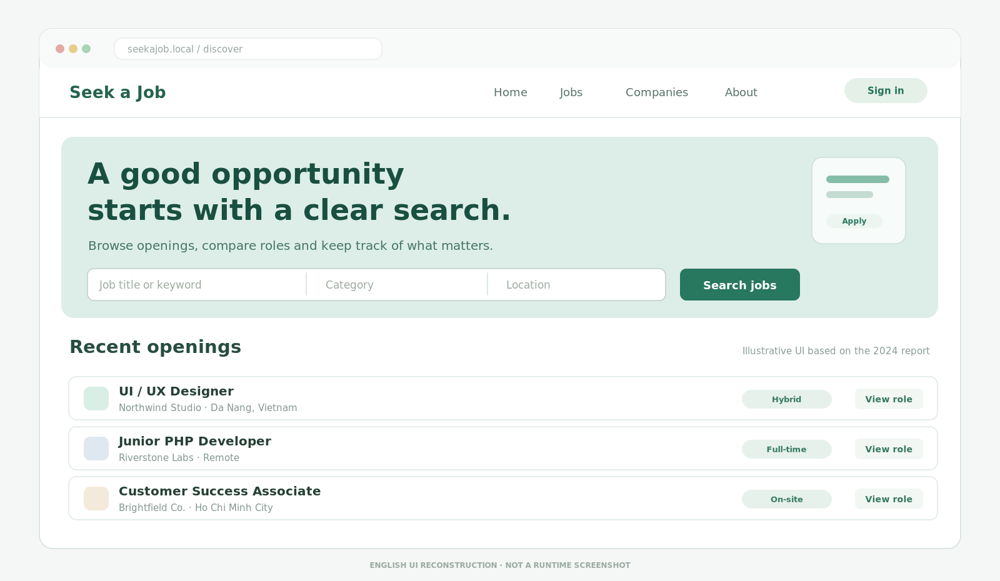

# Seek a Job

**A web platform for finding work and managing recruitment.**  
*Laravel · PHP · Blade · Eloquent · MySQL · 2024*

I built **Seek a Job** with **Đặng Quang Vinh** in 2024. We wanted a place where job seekers could discover opportunities and apply with a CV, while recruiters could post vacancies and follow applications without losing track of each person. There is also an administrator area for reviewing listings and user reports.

The experience follows a simple path: find a job, learn about the company, save or apply, and let the recruiter review the application. Behind it, Laravel connects the different roles through routes, controllers and Eloquent models.

## Explore the project

The personal story and design notes are available in [English](en/index.md) and [Tiếng Việt](vi/index.md). Both pages include diagrams and illustrations in English. The code is in [source/](source/), with the application and user guides under [docs/](docs/) and editable Word reports in [report/](report/).

## Run it locally

The Laravel application lives in `source/`. Start with the [setup guide](docs/SETUP_GUIDE.md). You'll need PHP and Composer, an appropriate database configuration, and the main recruitment tables. The repository does not include migrations for all recruitment-domain tables; setting up a full database needs that schema first.

This is a student-built software project, not a production hiring service. The next areas to strengthen are role permissions, CV privacy and end-to-end testing. These boundaries are described in [security notes](docs/SECURITY_AND_RELEASE_NOTES.md).

## Project information

- **Product:** Seek a Job
- **Authors:** Trần Hoàng Minh Vương and Đặng Quang Vinh
- **Developed:** 2024
- **Repository:** https://github.com/vuongthm/seek-a-job

Third-party packages and resources retain their respective licenses; see [CREDITS.md](CREDITS.md).
