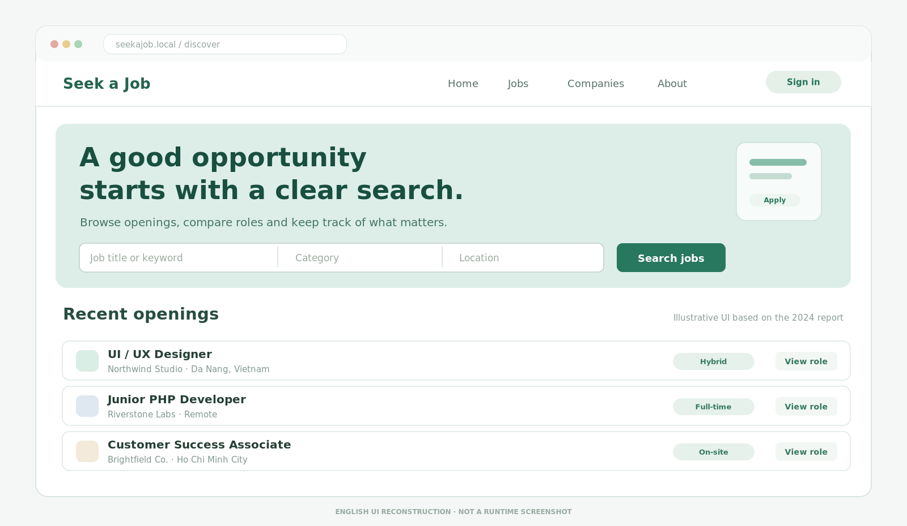
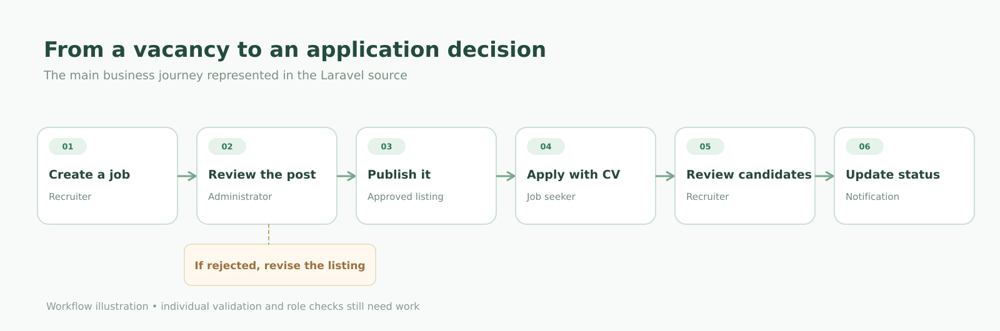
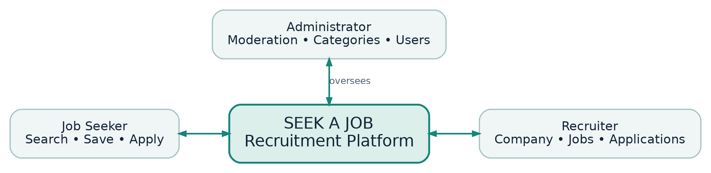
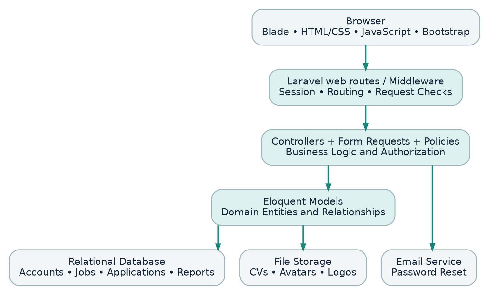

---
{
  "id": "seek-a-job",
  "cover": "../media/overview.svg",
  "title": "Seek a Job",
  "description": "A recruitment website that connects job search, applications and hiring decisions in one place.",
  "category": "Web development",
  "stack": ["PHP / Laravel 11", "Blade / Bootstrap", "Eloquent ORM", "MySQL", "JavaScript"],
  "repository": "https://github.com/vuongthm/seek-a-job",
  "status": "completed",
  "year": "2024",
  "order": 18
}
---

## Overview

A job search usually starts with a small hope: finding one opening that feels right. But the journey quickly spreads across job listings, company pages, saved links and CVs. Employers face a similar problem in reverse. They need to publish vacancies, review candidates and remember where each application stands.

**Seek a Job** is the recruitment website I built with **Đặng Quang Vinh in 2024**. We wanted to bring those everyday steps into one place. The site has three sides to it: job seekers can find roles and apply, recruiters can manage vacancies and applications, and administrators can review job listings and reports. It is a fairly simple idea, but it gave us a lot to think about while building it.

*Job discovery — an illustrative view of the search experience.*

## How it works

### Finding an opening

The journey begins with the job list. A visitor can search by keyword, browse categories, look for openings in a particular location and read about a company. If a vacancy looks promising, they can save it for later. When they are ready, they can apply with a CV.

I wanted this part to feel straightforward. Someone using the website should think about the job, not about the database tables behind it. In the application, `Job`, `Company`, `SavedJob` and `JobApplication` hold different pieces of that journey, but they belong to the same flow.

### Publishing a vacancy

Recruiters have their own workspace for company information and job posts. A vacancy goes through a review stage, where an administrator can approve or reject it. That review step is an important part of the product: the goal is not just to put listings online, but also to give the platform a way to handle unsuitable content.

*From posting a vacancy to receiving an application.*

### Following an application

Once a CV has been submitted, the recruiter can inspect the application and update its status. The data structure includes status history and user notifications so the applicant can follow the process beyond the initial submission. Those small details made me realize that a recruitment website is really about communication between people who see different sides of the same decision.

*Job seeker, recruiter and administrator responsibilities.*

### Inside the application

Seek a Job is a Laravel application built around the MVC pattern. Blade templates render the interface, routes direct requests to controllers, and Eloquent models represent the relationships between people, companies, jobs and applications. It all lives in one web application. I liked being able to trace a single action from the browser to the controller and then to the data it updates.

*The main parts of the Laravel application.*

## What I learned

The interesting challenge was not drawing the job cards. It was deciding **who can do what, and when**. A recruiter should only manage their own jobs. An administrator's decision should affect what applicants see. A CV is personal information, so handling it is different from handling a public job description.

The project has room to grow, especially around role permissions, private CV storage and a database schema that can be set up from scratch. It taught me to look beyond whether a screen works and think about the rules that make the whole system reliable.

## Source code

Seek a Job is a joint project by **Trần Hoàng Minh Vương** and **Đặng Quang Vinh**. The repository includes the Laravel source, technical documentation and English/Vietnamese project reports.

**GitHub:** [seek-a-job](https://github.com/vuongthm/seek-a-job)
