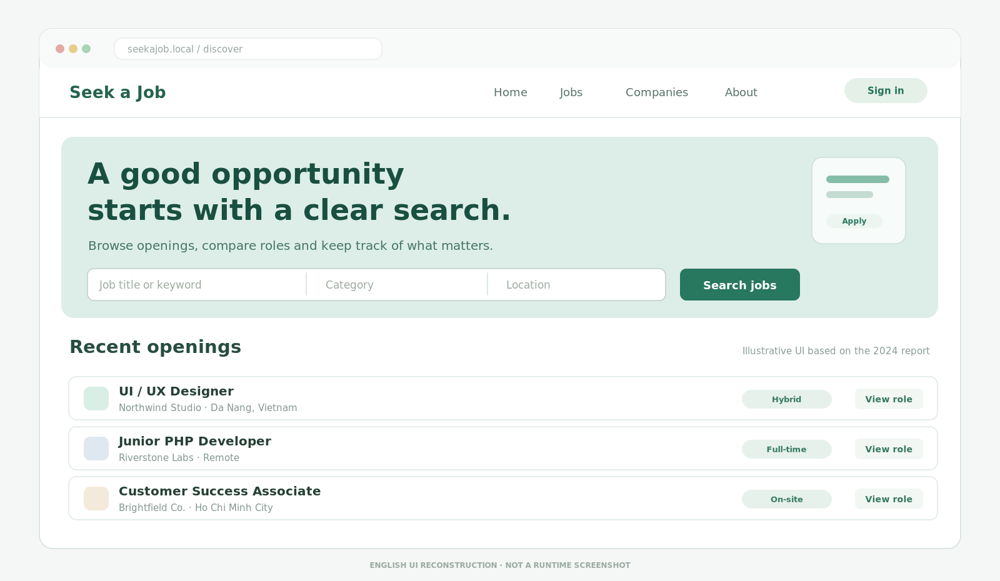
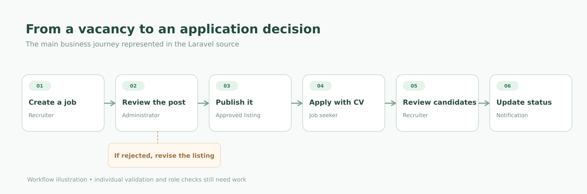
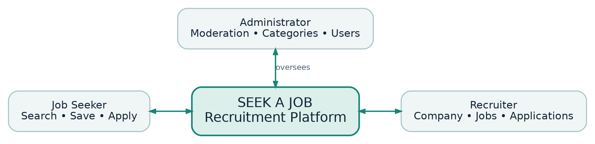
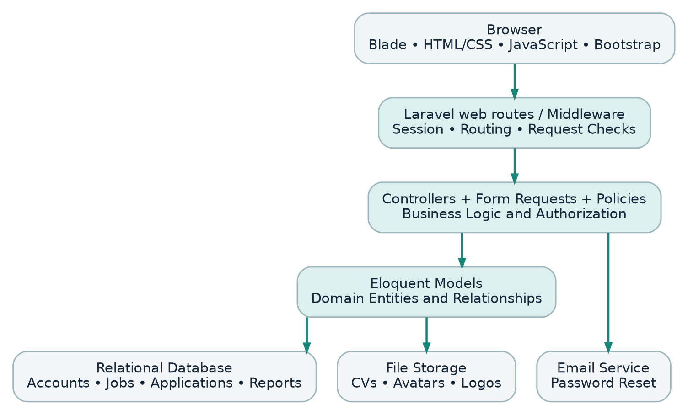

---
{
  "id": "seek-a-job",
  "cover": "../media/overview.svg",
  "title": "Seek a Job",
  "description": "Website tuyển dụng kết nối việc tìm kiếm, ứng tuyển và quản lý hồ sơ trong cùng một nơi.",
  "category": "Web development",
  "stack": ["PHP / Laravel 11", "Blade / Bootstrap", "Eloquent ORM", "MySQL", "JavaScript"],
  "repository": "https://github.com/vuongthm/seek-a-job",
  "status": "completed",
  "year": "2024",
  "order": 18
}
---

## Tổng quan

Một lần tìm việc thường bắt đầu từ hy vọng khá nhỏ: tìm được một vị trí phù hợp với mình. Nhưng càng tìm, mọi thứ càng dễ rời rạc — tin tuyển dụng ở một nơi, thông tin công ty ở nơi khác, CV gửi đi rồi lại không rõ đang được xem xét tới đâu. Phía nhà tuyển dụng cũng có những việc tương tự: đăng tin, xem hồ sơ và theo dõi kết quả của từng ứng viên.

**Seek a Job** là website tuyển dụng mình làm cùng **Đặng Quang Vinh vào năm 2024**. Tụi mình muốn gom những bước quen thuộc ấy vào một nơi. Website có ba góc nhìn: người tìm việc tìm kiếm và ứng tuyển, nhà tuyển dụng đăng tin và quản lý hồ sơ, còn quản trị viên kiểm duyệt các bài đăng và báo cáo. Ý tưởng nghe đơn giản, nhưng khi bắt tay xây dựng thì có khá nhiều điều phải cân nhắc.

*Không gian tìm việc — hình minh họa cho trải nghiệm tìm kiếm.*

## Cách hoạt động

### Bắt đầu từ một công việc phù hợp

Người dùng có thể tìm việc theo từ khóa, xem nhóm ngành nghề, chọn địa điểm và tìm hiểu công ty trước khi quyết định. Gặp một tin đáng quan tâm nhưng chưa muốn ứng tuyển ngay thì có thể lưu lại. Khi đã sẵn sàng, họ gửi hồ sơ kèm CV.

Mình muốn phần này càng dễ dùng càng tốt. Người tìm việc chỉ cần tập trung vào công việc mình quan tâm, không cần nghĩ tới những gì đang diễn ra phía sau. Trong code, `Job`, `Company`, `SavedJob` và `JobApplication` là những thành phần khác nhau, nhưng với người dùng thì chúng nên tạo thành một hành trình liền mạch.

### Khi nhà tuyển dụng đăng tin

Nhà tuyển dụng có khu vực riêng để cập nhật thông tin công ty và quản lý tin tuyển dụng. Tin đăng được đưa qua bước kiểm duyệt để quản trị viên có thể chấp nhận hoặc từ chối. Mình thấy đây là một phần quan trọng của sản phẩm: không chỉ giúp tin được đăng lên, mà còn có cách xử lý những nội dung chưa phù hợp.

*Từ lúc đăng tuyển đến khi nhận được hồ sơ ứng viên.*

### Sau khi gửi CV

Đơn ứng tuyển không nên kết thúc ở một nút “Gửi”. Nhà tuyển dụng có thể xem hồ sơ và cập nhật trạng thái. Phần dữ liệu cũng có lịch sử trạng thái và thông báo để người ứng tuyển theo dõi quá trình. Làm đến đây mình mới thấy website tuyển dụng thực chất là một chuỗi trao đổi giữa những người đang đứng ở các phía khác nhau của cùng một quyết định.

*Ba vai trò chính: người tìm việc, nhà tuyển dụng và quản trị viên.*

### Những gì nằm sau giao diện

Seek a Job được xây dựng bằng Laravel, tổ chức theo mô hình MVC. Blade hiển thị giao diện; route chuyển yêu cầu tới controller; Eloquent quản lý các model và mối quan hệ giữa tài khoản, công ty, công việc và hồ sơ ứng tuyển. Toàn bộ nằm trong một ứng dụng web. Nhờ vậy, mình có thể lần theo một thao tác từ trình duyệt đến phần code xử lý rồi tới dữ liệu được cập nhật.

*Các thành phần chính của ứng dụng Laravel.*

## Điều mình học được

Điều khó không hẳn là tạo một danh sách công việc đẹp mắt, mà là trả lời câu hỏi **ai được làm gì và vào thời điểm nào**. Nhà tuyển dụng chỉ nên quản lý dữ liệu của mình; quyết định của quản trị viên phải ảnh hưởng tới những gì người tìm việc nhìn thấy; còn CV là thông tin riêng tư, không thể xử lý giống một tin tuyển dụng công khai.

Dự án vẫn còn những phần cần hoàn thiện, đặc biệt là phân quyền, cách lưu CV an toàn và khả năng dựng lại cơ sở dữ liệu từ đầu. Với mình, đây cũng là bài học đáng nhớ: một màn hình chạy được chưa có nghĩa toàn bộ hệ thống đã đủ chắc chắn.

## Mã nguồn

Seek a Job là dự án mình thực hiện cùng **Đặng Quang Vinh**. Repository gồm mã nguồn Laravel, tài liệu kỹ thuật và hai báo cáo dự án bằng tiếng Việt và tiếng Anh.

**GitHub:** [seek-a-job](https://github.com/vuongthm/seek-a-job)
