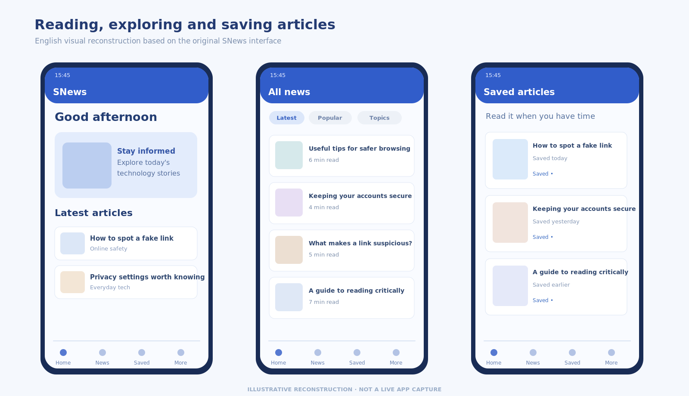

# SNews

**An Android news reader with a little more care for the links we open.**  
*Kotlin · Jetpack Compose · Firebase · VirusTotal · 2025*

I built **SNews** with **Nguyễn Việt Tín** in 2025. The app brings together the familiar parts of reading news — discovering stories, saving articles and joining conversations — with optional checks for suspicious links, files and phone numbers.

URL and file analysis connect to VirusTotal, while phone-number lookups use report information stored in Firestore. Those tools offer signals for a decision; they do not guarantee safety.

## Explore the project

Read the project story in [English](en/index.md) or [Tiếng Việt](vi/index.md). The application is in [source/](source/), architecture and setup notes are in [docs/](docs/), and the English/Vietnamese Word reports are in [report/](report/).

## Run it locally

Open the `source/` folder in Android Studio and follow the [setup guide](docs/SETUP_GUIDE.md). Firebase configuration and relevant service credentials must be supplied for your own environment. **Do not commit real API keys or `google-services.json`.** Android client-side keys are not a suitable place for secrets in a production app.

This is a learning and development project. Some features remain incomplete, including the bank-account lookup and social sign-in buttons. Runtime security claims have not been independently validated; see [security notes](docs/SECURITY_AND_RELEASE_NOTES.md).

## Project information

- **Product:** SNews
- **Authors:** Trần Hoàng Minh Vương and Nguyễn Việt Tín
- **Developed:** 2025
- **Repository:** https://github.com/vuongthm/snews-android

The project uses third-party libraries and online services under their own terms; see [CREDITS.md](CREDITS.md).
