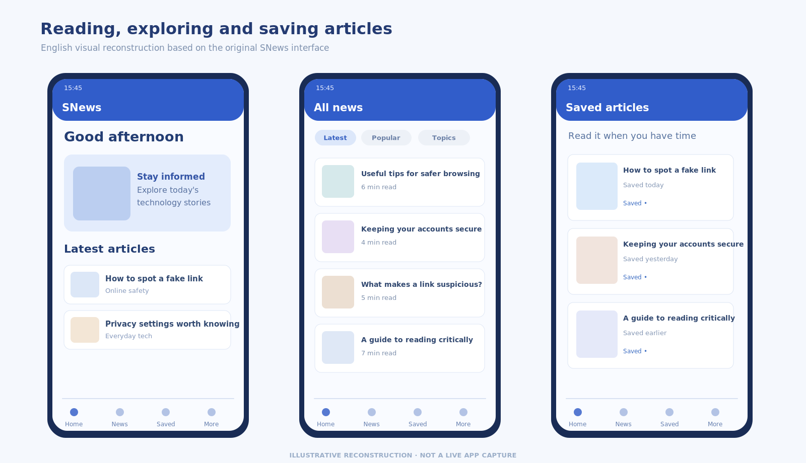
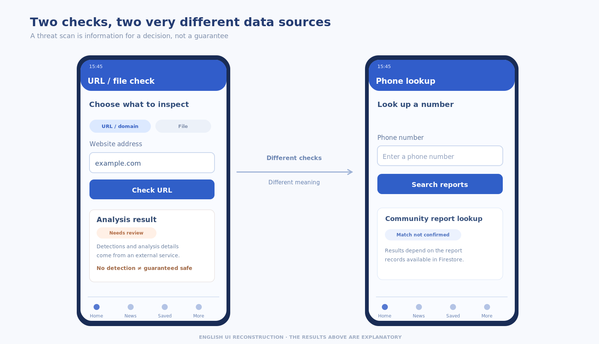
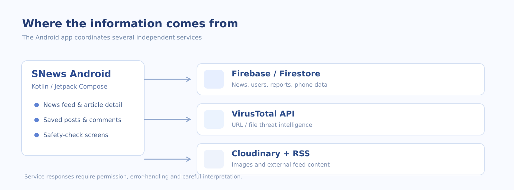

---
{
  "id": "snews-android",
  "cover": "../media/overview.svg",
  "title": "SNews",
  "description": "An Android news reader with tools for checking suspicious links, files and reported phone numbers.",
  "category": "Android development",
  "stack": ["Kotlin", "Jetpack Compose", "Firebase / Firestore", "Retrofit / OkHttp", "VirusTotal API"],
  "repository": "https://github.com/vuongthm/snews-android",
  "status": "completed",
  "year": "2025",
  "order": 19
}
---

## Overview

Sometimes the suspicious thing is right in the middle of an ordinary day: a link in a group chat, a file someone sends over, or a phone number we are not sure about. I liked the idea of keeping a small set of checking tools close to something people already do every day — reading the news.

That idea became **SNews**, an Android app I built with **Nguyễn Việt Tín in 2025**. It combines a news-reading experience with optional checks for URLs, files and phone numbers. It is a news app with useful safety tools, not an antivirus app or a guarantee that anything scanned is safe.

*A look at the reading and saved-articles experience.*

## How it works

### A place to read and return to

SNews begins like a familiar news app. People can browse articles, open a story, search by topic and bookmark something they want to revisit. The code also includes reactions, comments, user reports, RSS reading and article translation. I wanted the news part to remain useful on its own; no one should have to run a security scan just to read an article.

The interface is made with **Jetpack Compose**. ViewModels hold screen state, while repositories handle data operations and communication with services. Firebase Authentication and Firestore provide account and content features used by the application.

### Looking twice before opening something

The checking tools are there when the user needs them. URLs and files can be submitted to the **VirusTotal** integration for analysis. A phone-number lookup is a different kind of check: it searches relevant reports stored in **Firestore**. I kept those two ideas separate because they answer different questions.

A service may report detections, a user may have reported an incident, or there may simply be no matching records. Those results should be read as **signals**, not proof that a link, file or person is safe.

*URL analysis and phone-number lookup, shown with example content.*

### Letting people share a concern

The reporting flow allows a user to describe a suspicious case and attach supporting images. Reports are stored through Firestore, with Cloudinary handling image uploads. This was a useful part of the design for me: automated checks and community reports can complement each other without being treated as the same kind of evidence.

### What runs behind the screens

SNews uses Kotlin and a single Gradle `:app` module. Compose screens work with ViewModels and repositories, which communicate with Firebase and network services. **Retrofit/OkHttp** handle HTTP requests, and the project also uses **ML Kit** for translation and code for reading an RSS feed.

*The main application components and connected services.*

*How different services contribute to the app's features.*

## What I learned

The lesson I carried away from SNews is that **how we explain a result matters as much as getting the result**. A scan can be inconclusive. A phone-number report can be incomplete. A failed network request is not the same as a clean result. Making that distinction clear is part of designing a trustworthy interface.

There is still work to do. The bank-account check is a screen without a completed lookup, social sign-in buttons are not connected, and Firebase access rules need review before wider deployment. I see SNews as a solid learning project with room to make the experience and the security model more dependable.

## Source code

SNews is a joint project by **Trần Hoàng Minh Vương** and **Nguyễn Việt Tín**. The repository contains the Android source, setup documentation and English/Vietnamese technical reports.

**GitHub:** [snews-android](https://github.com/vuongthm/snews-android)
