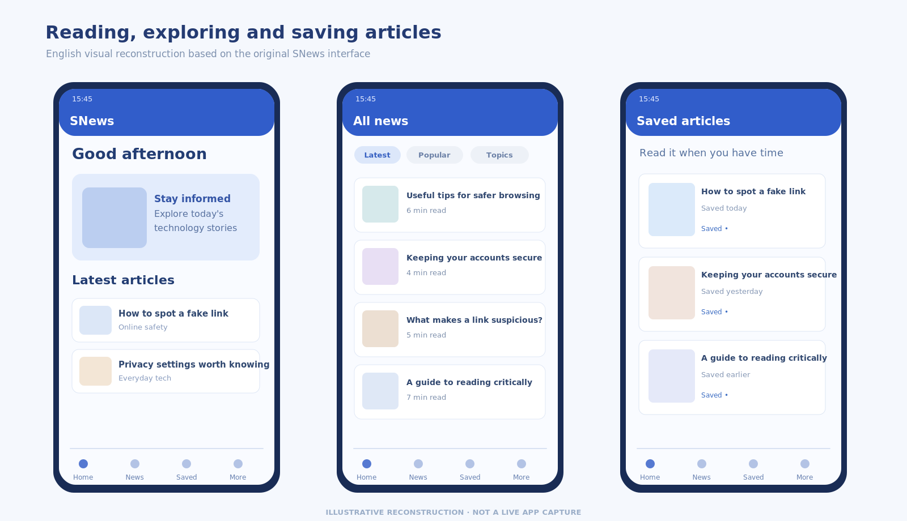
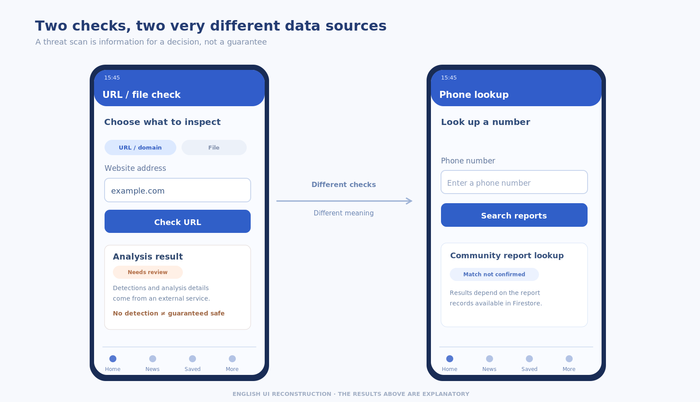
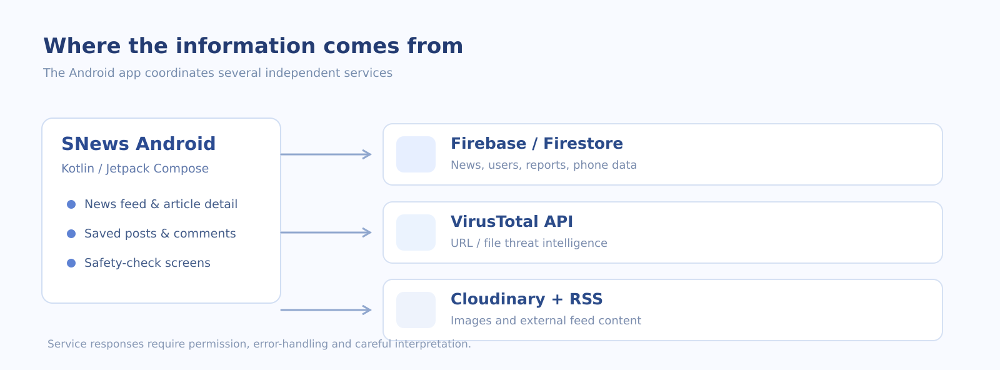

---
{
  "id": "snews-android",
  "cover": "../media/overview.svg",
  "title": "SNews",
  "description": "Ứng dụng Android để đọc tin và kiểm tra đường dẫn, tệp tin cùng số điện thoại đáng ngờ.",
  "category": "Android development",
  "stack": ["Kotlin", "Jetpack Compose", "Firebase / Firestore", "Retrofit / OkHttp", "VirusTotal API"],
  "repository": "https://github.com/vuongthm/snews-android",
  "status": "completed",
  "year": "2025",
  "order": 19
}
---

## Tổng quan

Đôi khi thứ khiến mình băn khoăn lại xuất hiện trong một ngày rất bình thường: một đường link trong nhóm chat, một tệp ai đó gửi hoặc một số điện thoại lạ. Mình nghĩ sẽ tiện hơn nếu những công cụ kiểm tra nhỏ gọn được đặt ngay cạnh một việc mà nhiều người vẫn làm mỗi ngày — đọc tin tức.

Từ ý tưởng đó, mình và **Nguyễn Việt Tín** làm **SNews** vào **năm 2025**. Đây là ứng dụng Android kết hợp đọc tin với các công cụ kiểm tra URL, tệp tin và số điện thoại khi cần. SNews không phải phần mềm diệt virus, cũng không thể bảo đảm một đối tượng là an toàn tuyệt đối chỉ từ một kết quả kiểm tra.

*Không gian đọc tin và lưu những bài muốn xem lại.*

## Cách hoạt động

### Đọc tin và lưu lại khi cần

SNews bắt đầu bằng những việc rất quen: lướt danh sách tin, mở bài viết, tìm theo chủ đề và đánh dấu bài muốn đọc lại. Trong mã nguồn còn có phần bình luận, bày tỏ cảm xúc, gửi báo cáo, đọc RSS và dịch bài viết. Mình muốn phần đọc tin vẫn là một trải nghiệm trọn vẹn; không ai cần phải quét bảo mật chỉ để xem một bài báo.

Giao diện được viết bằng **Jetpack Compose**. ViewModel giữ trạng thái màn hình, còn Repository xử lý dữ liệu và làm việc với các dịch vụ. Firebase Authentication và Firestore phụ trách những phần tài khoản và nội dung mà ứng dụng sử dụng.

### Kiểm tra trước khi mở

Khi gặp thứ đáng ngờ, người dùng có thể sử dụng khu vực kiểm tra. URL và tệp tin đi qua luồng tích hợp **VirusTotal** để xem kết quả phân tích. Với số điện thoại, cách kiểm tra khác hẳn: ứng dụng tìm các báo cáo có liên quan trong **Firestore**. Mình muốn tách rõ hai cách này vì chúng cho chúng ta những loại thông tin khác nhau.

Một dịch vụ có thể báo có dấu hiệu rủi ro, người dùng có thể từng gửi báo cáo, hoặc đơn giản là không tìm thấy dữ liệu. Những điều đó chỉ nên được hiểu là **thông tin để cân nhắc**, không phải giấy chứng nhận an toàn.

*Công cụ kiểm tra URL và tra cứu số điện thoại, với dữ liệu hiển thị minh họa.*

### Khi muốn chia sẻ một cảnh báo

Ứng dụng có phần để người dùng mô tả trường hợp đáng ngờ và gửi kèm hình ảnh. Báo cáo được xử lý qua Firestore, còn Cloudinary phụ trách tải hình lên. Mình thích ý tưởng này vì kiểm tra tự động và thông tin do cộng đồng cung cấp có thể hỗ trợ nhau, dù chúng không phải cùng một loại bằng chứng.

### Những gì ở phía sau giao diện

SNews được xây dựng bằng Kotlin với một module Gradle `:app`. Các màn hình Compose làm việc với ViewModel và Repository để kết nối Firebase cũng như các dịch vụ mạng. **Retrofit/OkHttp** xử lý các yêu cầu HTTP; ứng dụng còn dùng **ML Kit** cho chức năng dịch và có phần đọc tin từ nguồn RSS.

*Những thành phần chính của ứng dụng và các dịch vụ liên quan.*

*Mỗi dịch vụ hỗ trợ một phần khác nhau trong trải nghiệm của SNews.*

## Điều mình học được

Điều mình nhớ nhất khi làm SNews là **cách giải thích kết quả quan trọng không kém cách lấy ra kết quả**. Một lần quét có thể chưa có kết luận; báo cáo số điện thoại có thể thiếu thông tin; lỗi kết nối mạng cũng không thể xem như kết quả an toàn. Diễn đạt rõ những khác biệt đó là một phần của việc xây dựng giao diện đáng tin cậy.

Dự án vẫn còn những phần muốn hoàn thiện. Màn hình tra cứu số tài khoản chưa có xử lý đầy đủ, các nút đăng nhập qua mạng xã hội chưa được kết nối, và cần kiểm tra kỹ quy tắc truy cập Firebase trước khi dùng rộng rãi. Với mình, SNews là một dự án giúp học được nhiều điều, đồng thời còn nhiều chỗ để làm sản phẩm tốt hơn.

## Mã nguồn

SNews là dự án mình thực hiện cùng **Nguyễn Việt Tín**. Repository bao gồm mã nguồn Android, tài liệu cài đặt và báo cáo kỹ thuật bằng tiếng Việt và tiếng Anh.

**GitHub:** [snews-android](https://github.com/vuongthm/snews-android)
