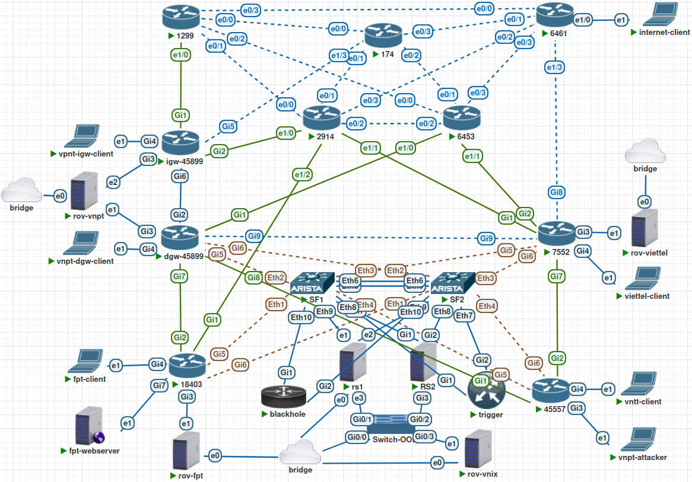
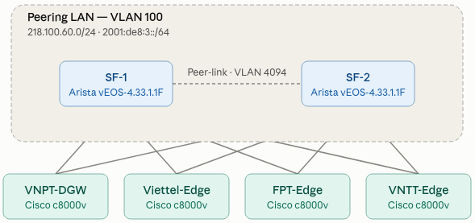
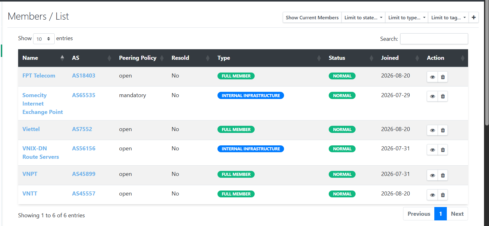
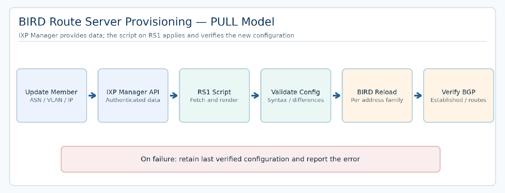
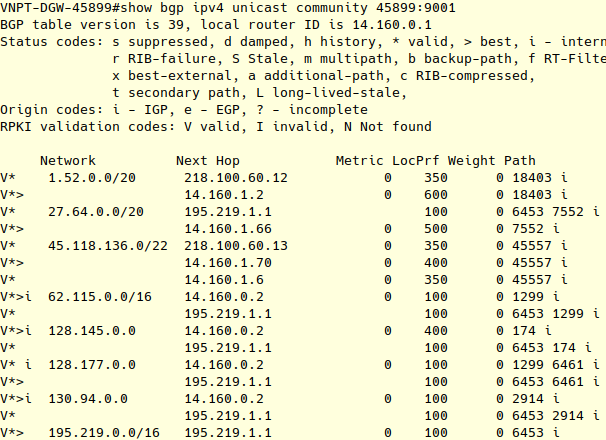
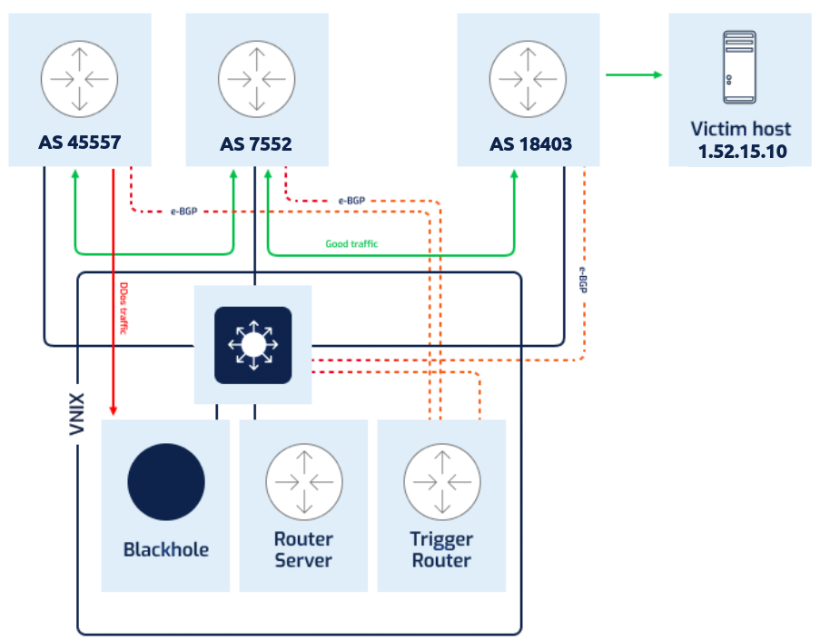

---
{
  "id": "vnix-ixp-lab",
  "cover": "../media/overview.svg",
  "title": "VNIX IXP Lab",
  "description": "A simulated VNIX-style Internet Exchange Point exploring BGP peering, network redundancy, routing security and route-server automation.",
  "category": "Network engineering",
  "stack": [
    "PNETLab",
    "BGP / BIRD 2",
    "Cisco IOS XE",
    "Arista vEOS / MLAG",
    "IXP Manager",
    "RPKI / RTBH"
  ],
  "repository": "https://github.com/vuongthm/vnix-ixp-lab",
  "status": "active",
  "year": "2026",
  "order": 21,
  "translations": {
    "ja": {
      "description": "PNETLab上にVNIXを参考にしたIXP検証環境を構築し、BGPピアリング、冗長化、RPKI/ROV、RTBH、Route Serverの設定自動化を検証するプロジェクト。"
    },
    "zh": {
      "description": "基于 PNETLab 搭建参考 VNIX 的互联网交换中心实验环境，研究 BGP 对等互联、冗余、RPKI/ROV、RTBH 及路由服务器配置自动化。"
    }
  }
}
---

## Overview

When a Viettel user accesses a service hosted on VNPT's network, which path does the traffic take? What happens if an exchange switch or a route server becomes unavailable?

**VNIX IXP Lab** explores these questions through hands-on experiments. Built in **PNETLab**, it simulates an **Internet Exchange Point (IXP)** where independent networks exchange routing information, select paths and recover from selected failures. The project was developed during an internship and draws on VNIX operating principles; **it does not represent the production VNIX infrastructure**.

The lab brings together **four domestic networks** (VNPT, Viettel, FPT and VNTT), **five simulated international autonomous systems**, two fabric switches, two route servers and supporting management and routing-security services. The design includes both IPv4 and IPv6 connectivity.

*The complete testbed: member networks, international connectivity, the VNIX core and a separate management network.*

## How it works

### Exchanging routes between networks

Members connect to a shared **Peering LAN** and use **BGP** to exchange reachability information. Two route servers facilitate **multilateral peering (MLPA)**, reducing the need for every member to establish separate bilateral BGP sessions. The lab also models **bilateral peering (BLPA/PNI)** and *transit* links so different path-selection policies can be tested.

A route server **distributes routing information; it does not carry member traffic**. Actual packets are forwarded across the members' data connections. An *Established* BGP session is therefore not sufficient evidence of end-to-end reachability.

### Keeping traffic flowing through failures

Two Arista vEOS switches (**SF1/SF2**) use **MLAG/LACP** to provide redundant access links. Failure scenarios remove a link or disable one switch, then examine interface state and continued connectivity inside the lab.

*MLAG provides link-layer resilience, while the independent route servers provide a separate layer of routing redundancy.*

Alongside the fabric, **RS1 runs BIRD 2** and **RS2 runs Cisco IOS XE**. Members establish separate BGP sessions with both. If one route server fails, routes learned through the other can remain usable, subject to each member's routing policy and network state.

### Centralizing management and automating configuration

Onboarding a member means keeping its **ASN, switch port, VLAN, peering addresses and BGP neighbors** consistent. **IXP Manager** organizes these records in one place rather than leaving them scattered across devices and spreadsheets.

*Member inventory and peering-related records in the experimental management interface.*

For the automation implemented in this project, **RS1 pulls information from IXP Manager through its API**, generates and validates its configuration, and reloads BIRD. This reduces repetitive manual changes when member records are updated.

*The API PULL workflow was tested for RS1/BIRD; equivalent automated provisioning was not implemented for the fabric switches or RS2.*

### Validating routes and responding to incidents

**RPKI/ROV** checks whether the **origin AS of an announced prefix** is authorized by the available ROA data. Routes are classified as *Valid*, *NotFound* or *Invalid*. Simulated route-hijacking scenarios examine how those results interact with BGP import policies and best-path selection.

*RPKI status observed in a BGP table. An Invalid classification does not by itself prove that a route was rejected.*

**RTBH (Remote Triggered Black Hole)** provides a separate incident-response mechanism. A BGP signal requests that traffic to a specified destination be discarded. The tests examine selective distribution to members, packet-dropping behavior and withdrawal of the blackhole route to restore reachability.

*The diagram shows RTBH signaling; actual packet drops depend on the receiving router's forwarding policy.*

## What I learned

My main takeaway was that **accepted configuration does not necessarily mean correct network behavior**. A BGP session can be up without importing the expected routes, and a route can exist without providing working connectivity. Reliable testing therefore needs evidence from both the **Control Plane** (sessions, policies and routing tables) and the **Data Plane** (packets, paths and service reachability).

The project also deepened my understanding of layered redundancy, the risks of routing-policy changes and the value of consistent management data for automation. Just as importantly, it taught me to **separate capabilities demonstrated in the lab from ideas that remain design proposals**, so the documentation accurately reflects the system.

## Source code

The repository contains per-device configurations, deployment scripts, operational guides and test scenarios. Vietnamese and English project reports are organized under `report/`.

**GitHub:** [vuongthm/vnix-ixp-lab](https://github.com/vuongthm/vnix-ixp-lab)
