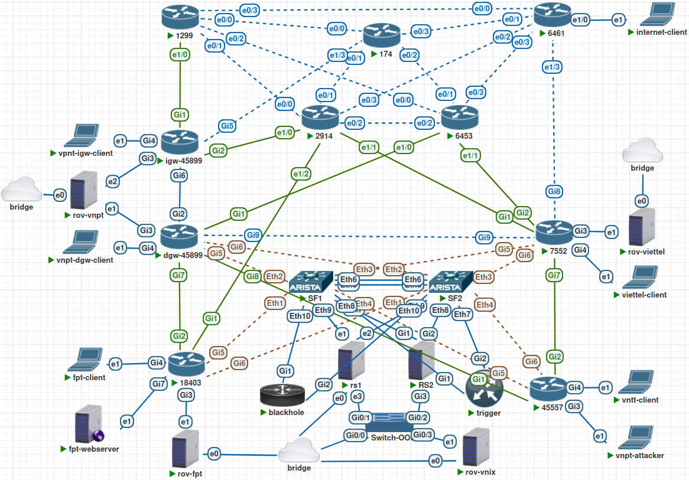
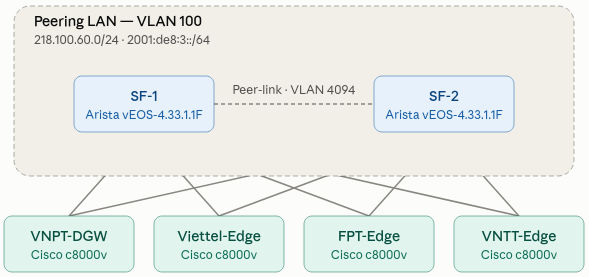
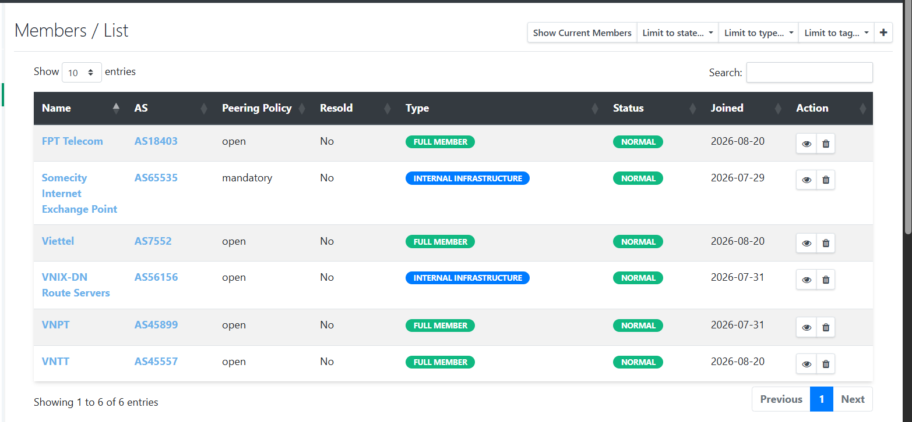
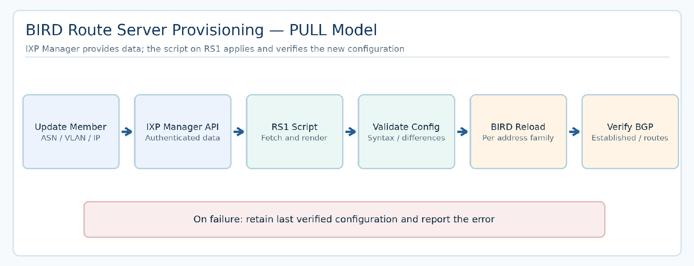
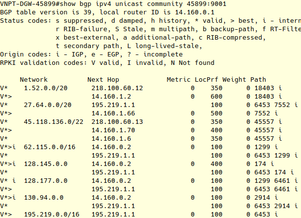
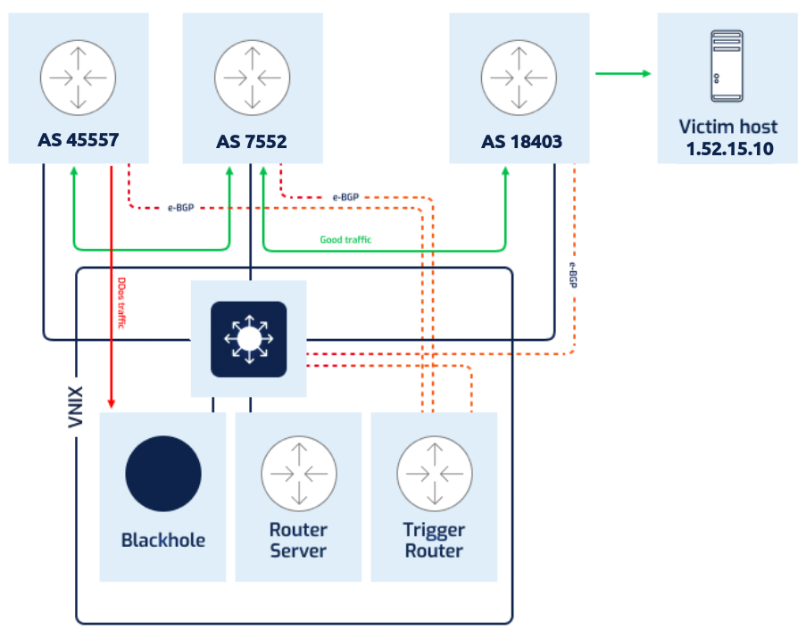

---
{
  "id": "vnix-ixp-lab",
  "cover": "../media/overview.svg",
  "title": "VNIX IXP Lab",
  "description": "Mô phỏng trạm trung chuyển Internet theo mô hình VNIX, kết hợp BGP peering, kết nối dự phòng, bảo mật định tuyến và tự động hóa Route Server.",
  "category": "Network engineering",
  "stack": [
    "PNETLab",
    "BGP / BIRD 2",
    "Cisco IOS XE",
    "Arista vEOS / MLAG",
    "IXP Manager",
    "RPKI / RTBH"
  ],
  "repository": "https://github.com/vuongthm/vnix-ixp-lab",
  "status": "active",
  "year": "2026",
  "order": 21,
  "translations": {
    "ja": {
      "description": "PNETLab上にVNIXを参考にしたIXP検証環境を構築し、BGPピアリング、冗長化、RPKI/ROV、RTBH、Route Serverの設定自動化を検証するプロジェクト。"
    },
    "zh": {
      "description": "基于 PNETLab 搭建参考 VNIX 的互联网交换中心实验环境，研究 BGP 对等互联、冗余、RPKI/ROV、RTBH 及路由服务器配置自动化。"
    }
  }
}
---

## Tổng quan

Một người dùng Viettel truy cập máy chủ của VNPT: lưu lượng sẽ đi thẳng giữa hai mạng hay phải qua một nhà cung cấp trung gian? Nếu một kết nối gặp sự cố, mạng sẽ chọn đường nào để tiếp tục hoạt động?

**VNIX IXP Lab** được xây dựng để tìm câu trả lời bằng thực nghiệm. Đây là mô hình **Internet Exchange Point (IXP)** trên PNETLab, mô phỏng cách các mạng độc lập trao đổi thông tin định tuyến, lựa chọn đường đi và duy trì dịch vụ khi xảy ra sự cố. Dự án được thực hiện trong quá trình thực tập, dựa trên những nguyên lý vận hành của VNIX, **không phải hệ thống VNIX đang hoạt động ngoài thực tế**.

Môi trường gồm **4 mạng nội địa** (VNPT, Viettel, FPT, VNTT), **5 AS quốc tế mô phỏng**, hai switch lõi, hai Route Server cùng các dịch vụ giám sát, xác thực tuyến và quản trị tập trung. IPv4 và IPv6 được đưa vào các bài toán kết nối của mô hình.

*Toàn cảnh topology: các mạng thành viên, kết nối quốc tế, VNIX Core và mạng quản trị riêng.*

## Cách hoạt động

### Trao đổi lưu lượng giữa các nhà mạng

Các mạng tham gia IXP kết nối vào một **Peering LAN** dùng chung. Thông qua **BGP**, chúng trao đổi thông tin về những mạng đích có thể đi tới. Hai Route Server hỗ trợ **peering đa phương (MLPA)**, giúp thành viên trao đổi tuyến với nhiều bên mà không cần tạo đầy đủ các phiên BGP song phương. Lab cũng có **BLPA/PNI** và kết nối *transit* để so sánh các đường đi theo chính sách.

Route Server chỉ **phân phối thông tin định tuyến**. Lưu lượng của người dùng được chuyển tiếp qua hạ tầng kết nối giữa các mạng, không đi xuyên qua Route Server. Vì vậy, một phiên BGP ở trạng thái *Established* chưa đủ để kết luận dịch vụ thực sự truy cập được.

### Duy trì kết nối khi thiết bị gặp sự cố

Hai switch Arista vEOS (**SF1/SF2**) sử dụng **MLAG/LACP** để cung cấp các nhánh kết nối dự phòng. Trong lab, nhóm thử rút một nhánh hoặc ngắt một switch, sau đó kiểm tra trạng thái liên kết và khả năng tiếp tục chuyển tiếp lưu lượng.

*MLAG dự phòng ở lớp chuyển mạch; thiết kế hai Route Server độc lập dự phòng ở lớp trao đổi tuyến.*

Song song với cặp switch, **RS1 chạy BIRD 2** và **RS2 chạy Cisco IOS XE** phục vụ các phiên BGP riêng. Khi một Route Server không khả dụng, thành viên vẫn có thể sử dụng tuyến học từ Route Server còn lại, tùy chính sách và trạng thái mạng.

### Quản trị tập trung và tự động cập nhật cấu hình

Khi thêm một thành viên, quản trị viên phải quản lý nhất quán **ASN, cổng kết nối, VLAN, địa chỉ peering và BGP neighbor**. **IXP Manager** tập trung các thông tin đó trong một hệ thống thay vì lưu rời rạc trên nhiều thiết bị.

*Giao diện quản lý thành viên và thông số peering trong môi trường thử nghiệm.*

Ở phần tự động hóa đã triển khai, **RS1 chủ động lấy dữ liệu từ IXP Manager qua API**, sinh và kiểm tra cấu hình, sau đó nạp thay đổi vào BIRD. Điều này giúp giảm thao tác nhập lệnh thủ công khi thông tin thành viên thay đổi.

*Quy trình API PULL đã được kiểm thử trên RS1/BIRD; cấu hình SF1/SF2 và RS2 chưa được tự động hóa theo cách này.*

### Kiểm tra an toàn định tuyến và xử lý sự cố

Với **RPKI/ROV**, lab kiểm tra tính hợp lệ của **AS nguồn công bố một prefix** dựa trên dữ liệu ROA. Các tuyến được phân loại thành *Valid*, *NotFound* hoặc *Invalid*. Nhóm mô phỏng những tình huống công bố tuyến bất thường để xem trạng thái xác thực và chính sách BGP ảnh hưởng thế nào đến việc chọn đường.

*Quan sát trạng thái RPKI trong bảng BGP; một tuyến bị đánh dấu Invalid không đồng nghĩa nó luôn bị loại nếu chính sách chưa yêu cầu.*

Một cơ chế khác là **RTBH (Remote Triggered Black Hole)**, dùng tín hiệu BGP để yêu cầu loại bỏ lưu lượng hướng tới đích xác định khi cần ứng phó sự cố. Bài thử xem xét cả phạm vi tác động theo thành viên, việc thực thi loại bỏ gói và quá trình gỡ tuyến để khôi phục kết nối.

*RTBH cho phép điều phối yêu cầu chặn; việc gói tin thực sự bị loại phụ thuộc cấu hình chuyển tiếp của thiết bị nhận tuyến.*

## Điều mình học được

Bài học lớn nhất là **cấu hình đúng chưa đồng nghĩa mạng hoạt động đúng**. Một phiên BGP có thể đã được thiết lập nhưng tuyến chưa được nhận đúng; một tuyến có thể xuất hiện trong bảng định tuyến nhưng lưu lượng vẫn không tới đích. Vì vậy, mỗi bài kiểm thử cần đối chiếu cả **Control Plane** (BGP, chính sách, bảng tuyến) và **Data Plane** (gói tin, đường đi, khả năng truy cập dịch vụ).

Dự án cũng giúp tôi hiểu cách thiết kế dự phòng theo từng lớp, kiểm soát rủi ro khi thay đổi chính sách và tổ chức dữ liệu để tự động hóa vận hành. Quan trọng hơn, tôi học cách **phân biệt kết quả đã kiểm thử trong lab với những ý tưởng mới ở mức thiết kế**, để tài liệu phản ánh đúng khả năng của hệ thống.

## Mã nguồn

Repository chứa cấu hình từng thiết bị, script triển khai, tài liệu hướng dẫn và các kịch bản kiểm thử. Báo cáo dự án bằng tiếng Việt và tiếng Anh nằm trong thư mục `report/` của repository.

**GitHub:** [vuongthm/vnix-ixp-lab](https://github.com/vuongthm/vnix-ixp-lab)
